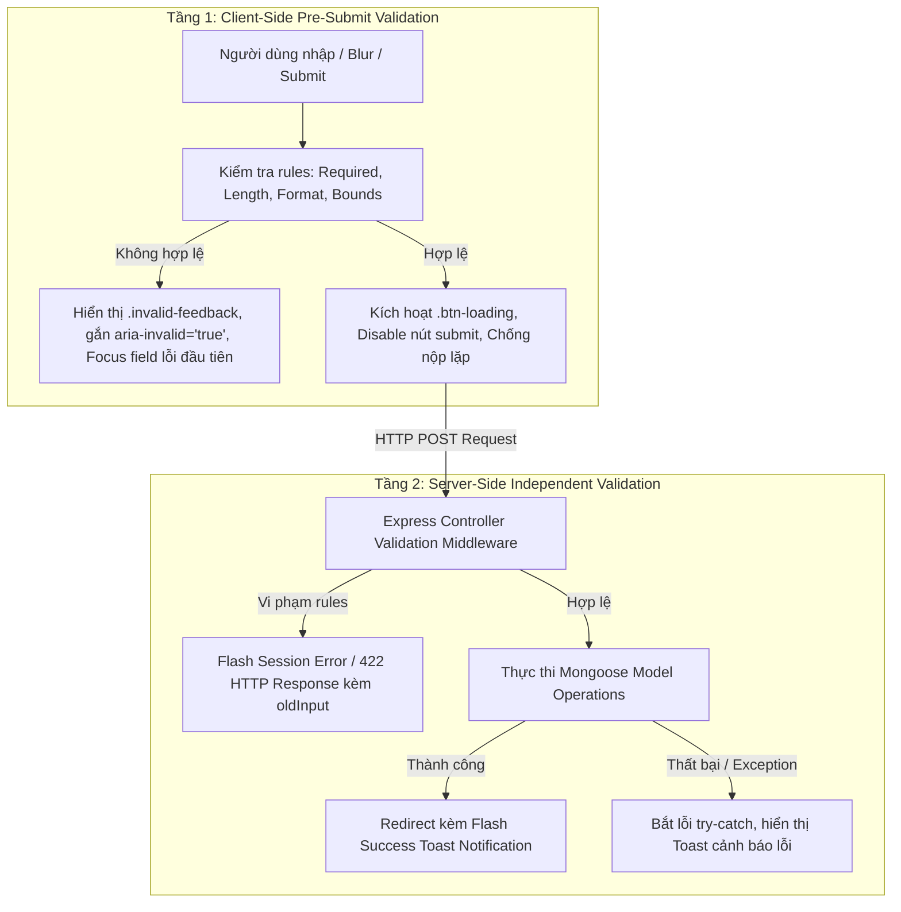
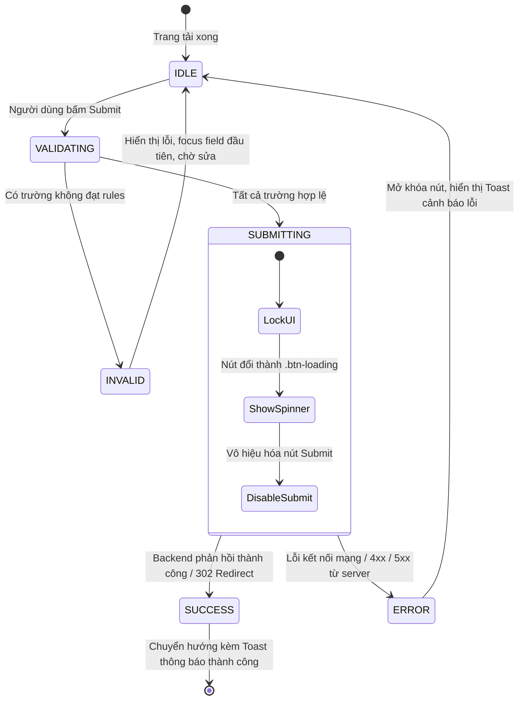
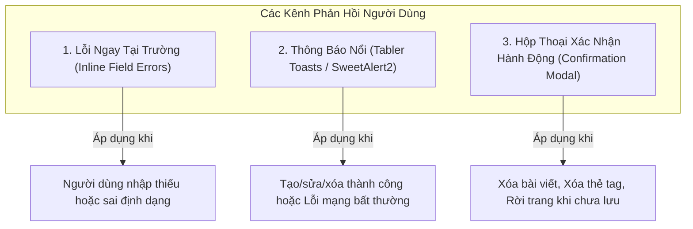
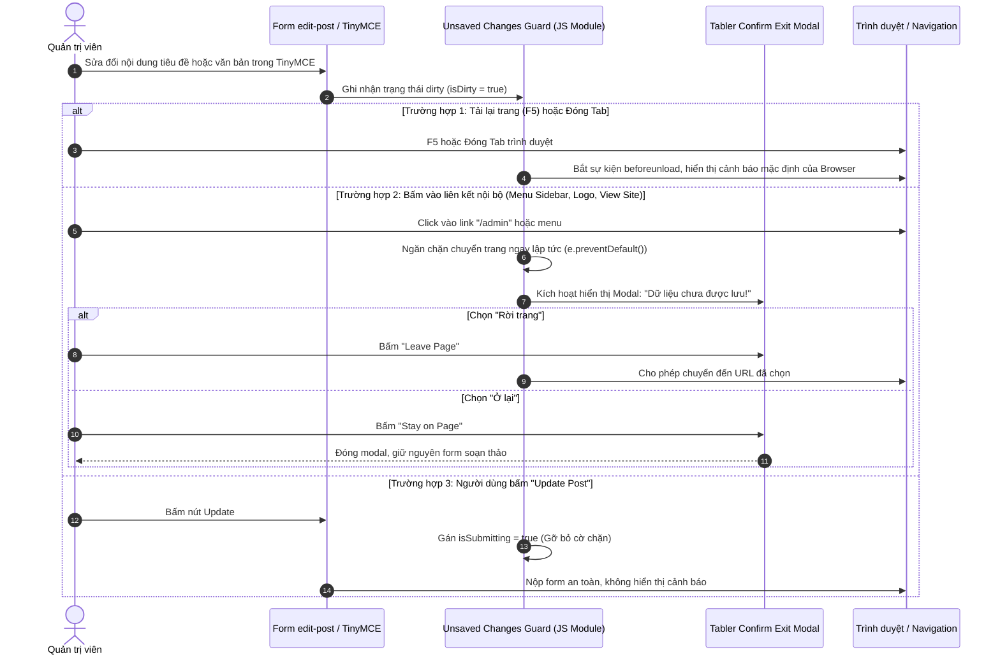

# Kế Hoạch Toàn Diện: Form Validation, Trạng Thái Submit & Phản Hồi Người Dùng (Admin CMS)

## 1. Tổng Quan & Phạm Vi (Executive Summary & Scope)

Tài liệu này xác lập kế hoạch thiết kế và chuẩn hóa cơ chế **Xác thực dữ liệu (Validation)**, **Quản lý trạng thái nộp form (Submit States)**, **Phòng chống submit lặp (Anti-Duplicate Submission)**, **Cảnh báo thay đổi chưa lưu (Unsaved Changes Guard)** và **Hệ thống thông báo phản hồi (Feedback & Notification System)** cho toàn bộ phân hệ quản trị Admin của repository **Blog Express App**.

### Phạm vi các form được áp dụng:
1. **Bài viết (Blog Posts)**: Form thêm mới (`add-post`) và Form chỉnh sửa (`edit-post`).
2. **Thẻ Tag (Tags)**: Form tạo mới (`add-tag`) và Form chỉnh sửa (`edit-tag`).
3. **Thao tác Hủy hoại / Không thể hoàn tác (Destructive Actions)**: Xóa bài viết (`delete-post`) và Xóa thẻ tag (`delete-tag`).
4. **Cấu hình Widget (CMS Components)**: 4 module (`about_author`, `newsletter`, `popular_articles`, `portfolio`).
5. **Xác thực Quản trị (Auth)**: Form đăng nhập (`login`).

---

## 2. Ma Trận Quy Tắc Xác Thực (Validation Rules Matrix)

Mọi quy tắc xác thực đều được áp dụng theo mô hình **Bảo mật đa tầng (Defense in Depth)**: Frontend kiểm tra tức thì để tối ưu trải nghiệm (UX); Backend kiểm tra độc lập để đảm bảo toàn vẹn dữ liệu (Data Integrity) và ngăn chặn bypass.



### 2.1. Form Bài viết (`add-post` & `edit-post`)
| Tên trường (Field) | Kiểu dữ liệu | Bắt buộc | Quy tắc Client-Side | Quy tắc Server-Side (Controller/Mongoose) | Thông báo lỗi chuẩn |
| :--- | :--- | :---: | :--- | :--- | :--- |
| `title` | Text | **Có** | - Không được để trống (sau khi trim).<br/>- Độ dài: 5 - 200 ký tự. | - `typeof title === 'string' && title.trim().length >= 5 && title.trim().length <= 200`. | "Tiêu đề bài viết là bắt buộc và phải có độ dài từ 5 đến 200 ký tự." |
| `summary` | Textarea | Không | - Tối đa 500 ký tự. | - `summary ? summary.trim().length <= 500 : true`. | "Đoạn tóm tắt không được vượt quá 500 ký tự." |
| `content` | TinyMCE WYSIWYG | **Có** | - Nội dung văn bản thuần (text stripped) tối thiểu 20 ký tự.<br/>- Đọc qua `tinymce.get('editor-content').getContent()`. | - Kiểm tra HTML string sau khi loại bỏ tags không được rỗng hoặc `< 20` ký tự. | "Nội dung bài viết không được để trống và phải có ít nhất 20 ký tự." |
| `status` | Select | **Có** | - Giá trị hợp lệ: `'1'` (Show) hoặc `'0'` (Hide). | - `['0', '1', 0, 1, true, false].includes(status)`. | "Trạng thái bài viết không hợp lệ." |
| `topic` | Text | Không | - Tối đa 100 ký tự. | - `topic ? topic.trim().length <= 100 : true`. | "Tên chuyên mục không được vượt quá 100 ký tự." |
| `tag` | Select2 Multiple | Không | - Mỗi thẻ tag: tối đa 50 ký tự.<br/>- Tối đa chọn 10 tags cho 1 bài viết. | - Chuyển sang chuỗi hoặc mảng, giới hạn độ dài từng tag `<= 50`. | "Bạn chỉ có thể chọn tối đa 10 thẻ tag cho mỗi bài viết." |
| `thumbnail` | Text (URL) | Không | - Định dạng URL hợp lệ hoặc đường dẫn relative hợp chuẩn.<br/>- Phần mở rộng hợp lệ: `.jpg, .jpeg, .png, .webp, .gif`. | - Regex URL format hoặc đường dẫn Cloudinary hợp lệ. | "Đường dẫn ảnh đại diện không hợp lệ (hỗ trợ .jpg, .png, .webp, .gif)." |

---

### 2.2. Form Thẻ Tag (`add-tag` & `edit-tag`)
| Tên trường | Kiểu dữ liệu | Bắt buộc | Quy tắc Client-Side | Quy tắc Server-Side | Thông báo lỗi chuẩn |
| :--- | :--- | :---: | :--- | :--- | :--- |
| `name` | Text | **Có** | - Độ dài: 2 - 50 ký tự.<br/>- Không chứa ký tự đặc biệt gây lỗi URL (`<`, `>`, `"`, `'`, `/`, `\`). | - `name.trim().length >= 2 && name.trim().length <= 50`.<br/>- Kiểm tra trùng lặp tên tag trong MongoDB (`tagsModel.findOne({ name })`). | "Tên thẻ tag phải từ 2 đến 50 ký tự và không được trùng với tag đã có." |
| `prioritize` | Select | **Có** | - Giá trị hợp lệ: `'0'` (Secondary) hoặc `'1'` (Primary). | - `['0', '1', 0, 1].includes(prioritize)`. | "Mức ưu tiên không hợp lệ." |

---

### 2.3. Form Cấu hình Widget (CMS Components)
1. **Module `about_author`**:
   - `name`: Bắt buộc, 2 - 100 ký tự $\to$ "Tên tác giả phải từ 2 đến 100 ký tự."
   - `description`: Tối đa 1000 ký tự $\to$ "Mô tả tiểu sử không quá 1000 ký tự."
2. **Module `newsletter`**:
   - `title`: Bắt buộc, 5 - 150 ký tự $\to$ "Tiêu đề bản tin từ 5 đến 150 ký tự."
   - `description`: Tối đa 500 ký tự.
   - `bgimage`: Định dạng URL ảnh hợp lệ.
3. **Module `popular_articles`**:
   - `title`: Bắt buộc, 5 - 200 ký tự.
   - `author`: Bắt buộc, 2 - 100 ký tự.
   - `link`: Bắt buộc, định dạng URL hợp lệ hoặc relative link (bắt đầu bằng `/` hoặc `http`).
4. **Module `portfolio`**:
   - `name`: Bắt buộc, 2 - 100 ký tự.
   - `linkcv`: Định dạng URL hợp lệ (nếu có nhập).

---

### 2.4. Form Xác thực Quản trị (`login`)
| Tên trường | Kiểu dữ liệu | Bắt buộc | Quy tắc Client-Side | Quy tắc Server-Side | Thông báo lỗi |
| :--- | :--- | :---: | :--- | :--- | :--- |
| `username` | Text | **Có** | - Không rỗng, 3 - 50 ký tự. | - Kiểm tra tồn tại trong CSDL. | "Vui lòng nhập tên tài khoản quản trị (tối thiểu 3 ký tự)." |
| `password` | Password | **Có** | - Không rỗng, tối thiểu 6 ký tự. | - So khớp mật khẩu đã băm trong CSDL. | "Mật khẩu không được để trống (tối thiểu 6 ký tự)." |

---

## 3. Kiến Trúc Quản Lý Trạng Thái Nộp Form & Chống Nộp Lặp (Submit State Machine)

Hệ thống sử dụng một máy trạng thái (State Machine) quản lý tiến trình nộp form nhằm ngăn chặn hoàn toàn việc người dùng nhấp đúp (double-click) hoặc gửi liên tiếp nhiều request làm trùng lặp bản ghi.



### Chi tiết hành vi kỹ thuật:
1. **Trạng thái `VALIDATING`**:
   - Thu thập toàn bộ giá trị các input (kể cả iframe TinyMCE và Select2).
   - Kiểm tra tuần tự từng trường. Nếu phát hiện vi phạm:
     - Gắn class `.is-invalid` vào thẻ input/select.
     - Hiển thị thông báo trong phần tử `<div class="invalid-feedback" id="{field}-error">`.
     - Gắn thuộc tính `aria-invalid="true"` và `aria-describedby="{field}-error"` vào input.
     - **Tự động cuộn trang (Smooth Scroll) và đưa con trỏ (Focus) đến phần tử lỗi đầu tiên**.
     - Hủy sự kiện gửi form (`event.preventDefault()`).
2. **Trạng thái `SUBMITTING`**:
   - Khi validation hợp lệ, thêm class `.btn-loading` vào nút bấm Submit (hiệu ứng vòng xoay quay tròn của Tabler).
   - Đặt thuộc tính `disabled = true` trên nút bấm và thiết lập cờ `isSubmitting = true`.
   - Bỏ kích hoạt sự kiện submit trên form để loại trừ hoàn toàn các click tiếp theo.
   - Nếu trong vòng 15 giây không có phản hồi từ máy chủ (timeout), tự động gỡ bỏ trạng thái loading và hiển thị thông báo lỗi mạng cho người dùng.

---

## 4. Hệ Thống Thông Báo & Phản Hồi Người Dùng (Feedback & Notification System)

Hệ thống thông báo được phân tách thành 3 cơ chế chuyên biệt phù hợp với từng ngữ cảnh:



### 4.1. Thông Báo Ngay Tại Trường (Inline Field Errors)
- Sử dụng cấu trúc HTML chuẩn của Tabler / Bootstrap 5:
  ```html
  <div class="mb-3">
      <label class="form-label required" for="post-title">Title</label>
      <input type="text" class="form-control is-invalid" id="post-title" name="title"
             aria-invalid="true" aria-describedby="post-title-error" required />
      <div class="invalid-feedback" id="post-title-error" role="alert">
          <i class="ti ti-alert-circle me-1"></i> Tiêu đề bài viết không được để trống (tối thiểu 5 ký tự).
      </div>
  </div>
  ```
- **Hành vi Real-time**: Sau lần bấm submit đầu tiên, lắng nghe sự kiện `input` hoặc `change` trên trường bị lỗi để tự động gỡ bỏ class `.is-invalid` ngay khi người dùng sửa đúng, giúp giảm ức chế tâm lý (Cognitive Load).

### 4.2. Thông Báo Nổi Toàn Cục (Toast Notifications)
- Hiển thị ở góc trên bên phải màn hình (`top-end`), nổi trên layout.
- **Toast Thành công (Success)**:
  - Icon: `<i class="ti ti-circle-check text-success fs-2"></i>`.
  - Màu viền/nền: Success accent.
  - Tự động ẩn sau **4 giây** (Auto-dismiss), có thanh tiến trình (progress bar) và nút đóng `X`.
- **Toast Lỗi / Thất bại (Error)**:
  - Icon: `<i class="ti ti-alert-triangle text-danger fs-2"></i>`.
  - **Không tự động tắt** cho đến khi người dùng chủ động bấm đóng hoặc thao tác lại thành công.
- **Cơ chế truyền thông điệp từ Backend (Flash Notification)**:
  - Controller redirect kèm query parameter mã hóa an toàn: `/admin?toast=post_created&status=success` hoặc qua session flash `req.session.toast = { type: 'success', message: 'Bài viết đã được xuất bản thành công!' }`.
  - View layout đọc và kích hoạt Toast hiển thị ngay khi nạp trang.

### 4.3. Hộp Thoại Xác Nhận Hành Động Hủy Hoại (Accessible Confirmation Modal)
Thay thế hoàn toàn lệnh `confirm()` thô sơ của trình duyệt bằng **Tabler Danger Confirmation Modal**:
- **Cấu trúc**:
  - Tiêu đề đỏ nổi bật kèm icon cảnh báo: `<i class="ti ti-trash-x text-danger fs-1"></i>`.
  - Tên đối tượng cụ thể bị tác động: *"Bạn có chắc chắn muốn xóa bài viết '**Kinh nghiệm lập trình Node.js**'? Thao tác này không thể hoàn tác."*.
  - Nút bấm:
    - Nút **Hủy bỏ (Cancel)**: Đặt làm mặc định được focus khi mở modal (Safe Default).
    - Nút **Xác nhận xóa (Confirm Delete)**: Nút màu đỏ (`btn-danger`).
- **Khả năng tiếp cận**: Hỗ trợ phím `Escape` để hủy, bẫy tiêu điểm (Focus Trap) bên trong modal.

---

## 5. Cơ Chế Cảnh Báo Thay Đổi Chưa Lưu (Unsaved Changes Navigation Guard)

Áp dụng chuyên biệt cho trang **`edit-post`** (và form `add-post` khi đã nhập nội dung):



### Chi tiết tích hợp TinyMCE & Input:
- **Khởi tạo trạng thái**: Lưu bản sao snapshot dữ liệu ban đầu của form khi vừa tải trang.
- **Lắng nghe TinyMCE**: Bắt sự kiện `editor.on('change keyup NodeChange', ...)` và kiểm tra `editor.isDirty()`.
- **Lắng nghe Form Inputs**: Lắng nghe sự kiện `input` và `change` trên toàn bộ các thẻ input, select2, textarea.

---

## 6. Tiêu Chuẩn Khả Năng Tiếp Cận & Screen Reader (Accessibility & WCAG 2.1)

1. **Liên kết ngữ nghĩa Input - Error**:
   - Thuộc tính `aria-invalid="true"` được bật khi có lỗi.
   - Thuộc tính `aria-describedby="{id}-error"` giúp screen reader đọc to thông báo lỗi ngay khi người dùng tab tới ô nhập liệu.
2. **Quản lý Tiêu điểm (Focus Management)**:
   - Khi bấm submit thất bại, script gọi `document.getElementById(firstErrorFieldId).focus()` để đưa bàn phím trực tiếp vào vị trí cần sửa.
3. **Khu vực Đọc Động (Live Regions)**:
   - Các Toast thông báo được bọc bởi `role="status"` và `aria-live="polite"` để phần mềm trợ thính tự động thông báo kết quả cho người khiếm thị mà không làm gián đoạn luồng làm việc.
4. **Hỗ trợ Bàn phím Toàn diện**:
   - Tất cả các nút bấm, icon đóng, dropdown chọn tag đều có thể điều khiển 100% bằng phím `Tab`, `Space`, `Enter`, và `Escape`.

---

## 7. Ma Trận Kịch Bản Kiểm Thử & Tiêu Chí Nghiệm Thu (Test Cases & Acceptance Criteria)

| Mã ca (ID) | Tên ca kiểm thử | Mô tả kịch bản thực hiện | Tiêu chí chấp nhận (Acceptance Criteria) |
| :--- | :--- | :--- | :--- |
| **TC-VAL-01** | Bỏ trống các trường bắt buộc trên `add-post` | 1. Mở `/admin/add-post`<br/>2. Không nhập Title, Content<br/>3. Bấm "Publish Post" | - Form **không được gửi** đi.<br/>- Ô Title và Content viền đỏ `.is-invalid`.<br/>- Con trỏ tự động nhảy vào ô Title.<br/>- Thông báo lỗi hiển thị rõ ràng bên dưới. |
| **TC-VAL-02** | Nhập tiêu đề quá ngắn hoặc quá dài | 1. Nhập Title = "Abc" (< 5 ký tự)<br/>2. Bấm Publish<br/>3. Thử lại với chuỗi > 200 ký tự | - Báo lỗi cụ thể: "Tiêu đề phải từ 5 đến 200 ký tự".<br/>- Không gửi request lên server. |
| **TC-VAL-03** | Thêm mới bài viết hợp lệ | 1. Nhập đầy đủ Title, Summary, chọn Tag, chọn ảnh, gõ nội dung TinyMCE<br/>2. Bấm Publish | - Nút đổi sang trạng thái `.btn-loading` (icon xoay tròn).<br/>- Không thể click lần 2 trong khi gửi.<br/>- Lưu thành công vào CSDL và redirect về `/admin` kèm Toast xanh: "Xuất bản bài viết thành công!". |
| **TC-VAL-04** | Chống nộp lặp (Double-Submit Prevention) | 1. Nhập form hợp lệ<br/>2. Nhấp đúp chuột liên thanh (Double/Triple click) vào nút Submit | - Chỉ có **duy nhất 1 request HTTP POST** được gửi đi.<br/>- Không tạo ra 2 bài viết trùng lặp trong MongoDB. |
| **TC-VAL-05** | Backend Validation độc lập (Bypass Protection) | 1. Dùng công cụ cURL/Postman gửi POST tới `/admin/add-post` với body `{ title: "" }` bỏ qua frontend | - Controller backend bắt lỗi, không ghi vào CSDL.<br/>- Trả về mã lỗi 422 hoặc redirect về trang form kèm thông báo lỗi. |
| **TC-VAL-06** | Tạo thẻ tag bị trùng tên | 1. Vào `/admin/add-tag`<br/>2. Nhập tên một tag đã tồn tại trong hệ thống<br/>3. Bấm Create | - Backend kiểm tra CSDL và báo lỗi: "Tên thẻ tag đã tồn tại, vui lòng chọn tên khác." |
| **TC-VAL-07** | Xác nhận xóa bài viết (Accessible Modal) | 1. Bấm nút Xóa bài viết tại một dòng<br/>2. Modal Tabler xuất hiện<br/>3. Thử bấm phím `Escape` hoặc nút "Hủy"<br/>4. Mở lại và bấm "Xác nhận xóa" | - Bấm Escape/Hủy: Modal đóng, bài viết không bị xóa.<br/>- Bấm Xác nhận xóa: Bài bị xóa khỏi CSDL, bảng tải lại kèm Toast thông báo thành công. |
| **TC-VAL-08** | Cảnh báo dữ liệu chưa lưu trên `edit-post` | 1. Mở `/admin/edit-post/:id`<br/>2. Thay đổi nội dung tiêu đề hoặc TinyMCE<br/>3. Bấm vào menu "Posts" trên Sidebar | - Xuất hiện modal cảnh báo: "Bạn có thay đổi chưa lưu. Bạn có chắc muốn rời trang?".<br/>- Chọn "Ở lại": Không chuyển trang, giữ nguyên nội dung đang sửa. |
| **TC-VAL-09** | Xử lý lỗi mất kết nối mạng (Network Error) | 1. Ngắt kết nối mạng hoặc tắt MongoDB<br/>2. Bấm nộp form | - Nút loading tự động dừng sau timeout.<br/>- Toast đỏ hiển thị: "Không thể kết nối đến máy chủ. Vui lòng kiểm tra đường truyền và thử lại." |
| **TC-VAL-10** | Kiểm thử bàn phím & Screen Reader | 1. Chỉ dùng phím `Tab` để di chuyển qua các trường và bấm `Enter` để submit khi form lỗi | - Tiêu điểm bàn phím tự động đặt vào trường lỗi đầu tiên.<br/>- Phần mềm screen reader đọc to nội dung thẻ `role="alert"`. |

