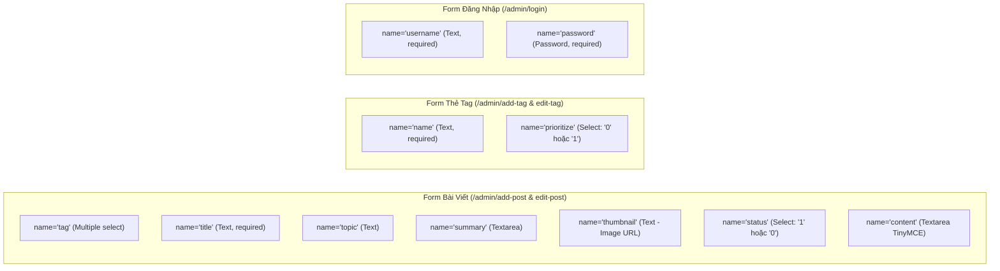

# Cơ Sở Chức Năng Cần Bảo Toàn & Yêu Cầu Điều Chỉnh (Functionality Baseline)

Tài liệu này xác định danh mục toàn bộ các chức năng Admin CMS hiện tại phải được bảo toàn, các yêu cầu bổ sung/loại bỏ mới được phê duyệt, cùng với các hợp đồng dữ liệu (Contracts) và phụ thuộc JavaScript nhạy cảm.

---

## 1. Danh Mục Chức Năng: Bảo Toàn, Bổ Sung & Loại Bỏ (Functionality Inventory)

### 1.1. Chức năng Mới Bổ Sung (Approved Additions)
| Tính năng | Vị trí giao diện | Mô tả chi tiết kỹ thuật |
| :--- | :--- | :--- |
| **Chuyển đổi Chế độ Sáng / Tối (Light / Dark Mode Toggle)** | Top Header & Sidebar | - Cung cấp nút toggle chuyển đổi giao diện trực quan (Icon Sun/Moon). - Sử dụng thuộc tính `data-bs-theme="dark"` hoặc `data-bs-theme="light"` trên thẻ `<body>`/`<html>`. - Lưu tùy chọn người dùng vào `localStorage.getItem('tablerTheme')`. - Nhúng inline script trong `<head>` để tự động nạp theme trước khi render, ngăn chặn hiện tượng chớp nháy màu (FOUC - Flash of Unstyled Content). |

### 1.2. Chức năng Loại Bỏ Vĩnh Viễn (Approved Removals)
| Thành phần | Vị trí liên quan | Hành động xử lý |
| :--- | :--- | :--- |
| **Trang Đăng Ký Admin (`register.ejs`)** | - Tệp tin `views/pages/admin/register.ejs` - Liên kết tại `views/pages/admin/login.ejs#L18` - Tuyến đường comment tại `routes/index.js#L17-L18` - Hàm `register` trong `controllers/indexController.js#L128-L148` | - **Xóa bỏ hoàn toàn tệp `views/pages/admin/register.ejs`**. - Xóa liên kết `"Do not have an account. Sign up now!"` trên form đăng nhập `login.ejs`. - Dọn dẹp các dòng comment route và hàm xử lý `register` thừa trong controller để bảo mật và tinh gọn codebase. |

---

### 1.3. Danh Mục Chức Năng Bắt Buộc Bảo Toàn (Must-Preserve Core Features)

| Module | Chức năng chi tiết | Trạng thái hiện tại | Yêu cầu bảo toàn khi Redesign |
| :--- | :--- | :--- | :--- |
| **Xác thực (Auth)** | Đăng nhập tài khoản Admin | `POST /admin/login` | Form nộp `username`, `password`, nhận session cookie `req.session.account` và redirect về `/admin`. |
| | Đăng xuất tài khoản | `GET /admin/logout` | Xóa session và chuyển hướng về `/admin/login`. |
| | Hiển thị thông tin phiên | Sidebar & Header | Hiển thị avatar và username của tài khoản đang đăng nhập từ `account`. |
| **Quản lý Bài viết** | Xem danh sách bài viết | `GET /admin` | Bảng hiển thị: Số thứ tự, Tác giả, Tag, Tiêu đề, Chuyên mục, Tóm tắt, Trạng thái (online/offline), Ngày tạo, Ngày cập nhật. |
| | Phân trang bài viết | `GET /admin/p/:page` | Thanh phân trang chuyển trang đúng cấu trúc URL `/admin/p/:page`. |
| | Xem trước bài viết trên Blog | Link `/post/:id` | Mở bài viết tương ứng trên giao diện người dùng. |
| | Tạo bài viết mới | `GET/POST /admin/add-post` | Form chọn thẻ tag (Select2 đa chọn), Tiêu đề, Chuyên mục, Tóm tắt, Trạng thái (Show/Hide), Ảnh đại diện (Flmngr), Soạn thảo nội dung (TinyMCE). |
| | Cập nhật bài viết | `GET /admin/edit-post/:id` `POST /admin/update-post?id=...` | Tự động điền dữ liệu cũ (prefill), cập nhật nội dung qua TinyMCE và thumbnail. |
| | Xóa bài viết | `POST /admin/delete-post?id=...` | Hộp thoại xác nhận (`confirm('Are you sure you want to delete?')`) và submit form POST xóa bài. |
| | Đồng bộ số đếm Thẻ Tag | Backend hook | Tự động tăng `quantity` thẻ tag khi thêm bài và giảm `quantity` khi xóa bài. |
| **Quản lý Thẻ Tag** | Xem danh sách thẻ tag | `GET /admin/tag` | Bảng hiển thị: Tên thẻ, Số lượng bài viết (`quantity`), Mức ưu tiên (`prioritize`: Primary/Secondary), Ngày tạo/sửa. |
| | Tạo thẻ tag mới | `GET/POST /admin/add-tag` | Nhập tên thẻ và mức ưu tiên (`0` hoặc `1`). |
| | Chỉnh sửa thẻ tag | `GET /admin/edit-tag/:id` `POST /admin/update-tag?id=...` | Prefill dữ liệu và cập nhật thẻ tag. |
| | Xóa thẻ tag | `POST /admin/delete-tag?id=...` | Xác nhận và xóa thẻ tag. |
| **Quản lý Widget (Components)** | Cấu hình 4 widget chính | `GET/POST /admin/components/:name` (`popular_articles`, `newsletter`, `portfolio`, `about_author`) | Cập nhật cấu hình đơn bản ghi (Singleton) qua cơ chế `upsert`. |
| | Xem trước trực tiếp (Live Preview) | EJS Partial Include | Hiển thị widget với giao diện thực tế của client (`useStyleClient: true`). |
| | Xem mã nguồn HTML | Highlight.js | Khối textarea hiển thị code HTML đã được format qua `html_beautify` và tô màu bởi `hljs`. |
| | Đổi ảnh nền widget | Flmngr / Thumbnail | Chọn ảnh đại diện/nền qua Flmngr picker. |
| **Thư viện Media** | Xem ảnh Cloudinary | `GET /admin/media-library` | Lưới ảnh hiển thị toàn bộ tài nguyên từ Cloudinary qua `getAllResources()`. |
| | Sao chép URL ảnh | Click nút `.js-copy` | Ghi đường dẫn ảnh vào Clipboard trình duyệt (`navigator.clipboard.writeText`). |

---

## 2. Bản Đồ Hợp Đồng Dữ Liệu & Ràng Buộc Phía Máy Chủ (Server Contracts)

### 2.1. Ràng buộc Tên Trường Form (Input `name` Attributes)
Backend Controller đọc trực tiếp dữ liệu từ `req.body` mà không có tầng DTO mapper trung gian. **Do đó, tuyệt đối không đổi tên các thuộc tính `name` của input sau đây**:

### 2.2. Ràng buộc Tuyến Đường Thao Tác (Action URLs & Query Params)
Các thao tác cập nhật và xóa phụ thuộc chặt chẽ vào tham số query `?id=...`:
- Cập nhật bài viết: `action="/admin/update-post?id=<%= blogs._id %>"` (Phương thức: `POST`).
- Xóa bài viết: `action="/admin/delete-post?id=<%= blog._id %>"` (Phương thức: `POST`).
- Cập nhật thẻ tag: `action="/admin/update-tag?id=<%= blogs._id %>"` (Phương thức: `POST`).
- Xóa thẻ tag: `action="/admin/delete-tag?id=<%= tag._id %>"` (Phương thức: `POST`).
- Cập nhật component: `action="/admin/components/<%= componentName %>"` (Phương thức: `POST`).

---

## 3. Danh Mục Phụ Thuộc DOM & Thư Viện Client (DOM & JS Dependencies)

| Selector | Loại | Vị trí sử dụng | Chức năng bắt buộc |
| :--- | :--- | :--- | :--- |
| `#editor-content` | Element ID | Form add-post, edit-post, components.ejs | Nơi TinyMCE gắn vào. Chứa thuộc tính `data-key="<%= process.env.FLMNGR_KEY %>"`. Bắt buộc phải tồn tại trong DOM (kể cả ẩn). |
| `#thumbnail-btn` | Element ID | Form add-post, edit-post, components | Nút bấm kích hoạt popup mở Flmngr File Manager. |
| `#thumbnail-input` | Element ID | Form add-post, edit-post, components | Thẻ input nhận đường dẫn URL của ảnh khi người dùng chọn xong từ Flmngr. |
| `.preview-image` | Class | Form add-post, edit-post, components | Khối chứa thẻ `` xem trước ảnh. Có class `.disable` khi chưa có ảnh. |
| `#select-tag` | Element ID | Form add-post, edit-post | Thẻ `<select multiple>` để thư viện Select2 khởi tạo giao diện chọn tag. |
| `.code-frame textarea` | Selector | `views/modules/*.ejs` | Thẻ textarea chứa source code để `html_beautify` và `hljs.highlightAll()` định dạng. |
| `.js-gallery-item` | Class | `views/components/upload.ejs` | Khối thẻ ảnh trong Media Library. |
| `.js-copy` | Class | `views/components/upload.ejs` | Nút copy URL ảnh vào Clipboard khi click. |
| `.pagination` | Class | `views/components/pagination.ejs` | Khối thanh phân trang với các liên kết `/admin/p/:page`. |
| `[data-theme-toggle]` | Attribute | Header & Sidebar | Nút bấm kích hoạt hàm chuyển đổi Dark/Light mode và cập nhật `localStorage`. |
