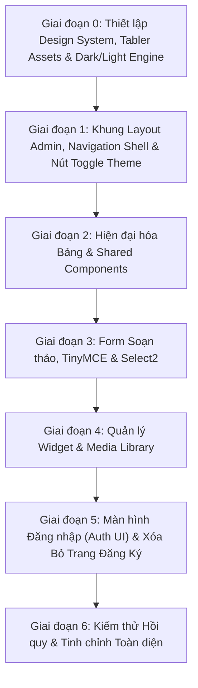

# Kế Hoạch Triển Khai Hiện Đại Hóa Admin UI/UX (Implementation Plan)

Kế hoạch này phân chia công việc tái thiết kế giao diện Admin CMS thành 6 giai đoạn lũy tiến (Phased Rollout). Kế hoạch đã tích hợp đầy đủ 2 yêu cầu mới: **Bổ sung tính năng chuyển đổi chế độ Light/Dark Mode** và **Xóa bỏ vĩnh viễn trang Đăng ký Admin (`register.ejs`)**.

---

## 1. Lộ Trình Triển Khai Tổng Quan (Phased Roadmap)

---

## 2. Chi Tiết Từng Giai Đoạn Triển Khai

### Giai đoạn 0: Thiết lập Design System, Tabler Assets & Dark/Light Engine
- **Mục tiêu**:
  - Tích hợp bộ tài nguyên **Tabler UI** (CSS & Vanilla JS) và **Tabler Icons** vào dự án.
  - Cấu hình font chữ tiêu chuẩn hiện đại (Inter) và bộ token màu sắc giao diện.
  - **Xây dựng động cơ chuyển đổi Chế độ Sáng / Tối (Light / Dark Mode Engine)**:
    - Hỗ trợ thuộc tính `data-bs-theme="dark"` và `data-bs-theme="light"` trên thẻ `<html>` hoặc `<body>`.
    - Script nhỏ nhúng tại `<head>` để đọc `localStorage.getItem('tablerTheme')` trước khi render, ngăn chặn hiện tượng chớp nháy màu (FOUC).
- **Files dự kiến ảnh hưởng**:
  - [views/templates/meta.ejs](file:///d:/Project/Personal/Blog_Express_App/views/templates/meta.ejs) (Thay thế `@webpixels/css` bằng Tabler CSS & Tabler Icons, bổ sung inline script khởi tạo theme).
  - [views/templates/block_script.ejs](file:///d:/Project/Personal/Blog_Express_App/views/templates/block_script.ejs) (Bổ sung `tabler.min.js`, script lắng nghe sự kiện toggle theme).
  - [public/css/admin.css](file:///d:/Project/Personal/Blog_Express_App/public/css/admin.css) (Dọn dẹp các quy tắc CSS ghi đè lỗi thời).
- **Độ ưu tiên**: 🔴 **Cao (P0)**
- **Rủi ro**: Lỗi FOUC (chớp màu trắng trước khi sang đen khi reload trang) nếu script đọc theme đặt sau khi render DOM.
- **Tiêu chí hoàn thành (DoD)**:
  - Tài nguyên Tabler tải thành công, console trình duyệt không có lỗi 404.
  - Cơ chế lưu và nạp theme từ `localStorage` hoạt động trơn tru không bị chớp màn hình.

---

### Giai đoạn 1: Khung Layout Admin, Navigation Shell & Nút Toggle Theme
- **Mục tiêu**:
  - Xây dựng lại layout khung [admin-layout.ejs](file:///d:/Project/Personal/Blog_Express_App/views/layouts/admin-layout.ejs) theo kiến trúc chuẩn của Tabler (`page`, `page-wrapper`, `navbar navbar-vertical`).
  - Hiện đại hóa thanh Sidebar [views/components/navbar.ejs](file:///d:/Project/Personal/Blog_Express_App/views/components/navbar.ejs): menu phân cấp gọn gàng, icon Tabler sắc nét, hỗ trợ thu gọn (collapse) mượt mà trên Mobile.
  - **Tích hợp nút chuyển đổi Light/Dark Mode**:
    - Đặt nút bấm biểu tượng Mặt trời / Mặt trăng (Sun / Moon icon) nổi bật trên thanh Top Header và thanh Sidebar.
    - Click vào nút sẽ chuyển đổi qua lại giữa Light và Dark mode kèm hiệu ứng chuyển màu êm dịu (smooth transition).
  - Hiện đại hóa Top Header [views/components/header.ejs](file:///d:/Project/Personal/Blog_Express_App/views/components/header.ejs): hiển thị breadcrumb, tiêu đề trang động, nút hành động `+ Create` theo biến `action`, avatar và dropdown menu người dùng.
- **Files dự kiến ảnh hưởng**:
  - [views/layouts/admin-layout.ejs](file:///d:/Project/Personal/Blog_Express_App/views/layouts/admin-layout.ejs)
  - [views/components/navbar.ejs](file:///d:/Project/Personal/Blog_Express_App/views/components/navbar.ejs)
  - [views/components/header.ejs](file:///d:/Project/Personal/Blog_Express_App/views/components/header.ejs)
  - [views/pages/admin/index.ejs](file:///d:/Project/Personal/Blog_Express_App/views/pages/admin/index.ejs)
- **Độ ưu tiên**: 🔴 **Cao (P0)**
- **Rủi ro**: Lỗi responsive trên mobile khi bấm nút mở menu; mất liên kết đăng xuất hoặc hiển thị sai username.
- **Tiêu chí hoàn thành (DoD)**:
  - Layout hiển thị chuẩn xác trên cả màn hình Desktop (>= 1200px) và Mobile (< 768px).
  - Nút bấm Toggle Light/Dark mode hoạt động mượt mà ở cả Header và Sidebar.
  - Avatar, username và liên kết Logout hoạt động bình thường.

---

### Giai đoạn 2: Hiện đại hóa Bảng & Shared Components (Data Tables & Pagination)
- **Mục tiêu**:
  - Nâng cấp bảng danh sách bài viết [views/components/blog.ejs](file:///d:/Project/Personal/Blog_Express_App/views/components/blog.ejs) và danh sách thẻ tag [views/components/tag.ejs](file:///d:/Project/Personal/Blog_Express_App/views/components/tag.ejs).
  - Bổ sung Badge trạng thái hiện đại tương thích cả 2 chế độ sáng/tối: `Online` (Xanh lục / success), `Offline` (Xám / secondary).
  - Thay thế các nút thao tác cũ bằng nhóm nút hành động chuẩn Tabler (View, Edit, Delete với icon trực quan).
  - Thiết kế lại thanh phân trang [views/components/pagination.ejs](file:///d:/Project/Personal/Blog_Express_App/views/components/pagination.ejs) theo class `pagination` của Bootstrap 5.
- **Files dự kiến ảnh hưởng**:
  - [views/components/blog.ejs](file:///d:/Project/Personal/Blog_Express_App/views/components/blog.ejs)
  - [views/components/tag.ejs](file:///d:/Project/Personal/Blog_Express_App/views/components/tag.ejs)
  - [views/components/pagination.ejs](file:///d:/Project/Personal/Blog_Express_App/views/components/pagination.ejs)
  - [views/pages/admin/tag-page.ejs](file:///d:/Project/Personal/Blog_Express_App/views/pages/admin/tag-page.ejs)
- **Độ ưu tiên**: 🔴 **Cao (P1)**
- **Rủi ro**: Mất thuộc tính `?id=...` trên form POST xóa bài/thẻ dẫn đến xóa thất bại.
- **Tiêu chí hoàn thành (DoD)**:
  - Bảng dữ liệu có thanh cuộn ngang mượt mà (`table-responsive`) trên di động.
  - Nút Xem mở đúng bài ngoài blog, nút Sửa chuyển đúng sang trang edit, nút Xóa hiển thị confirm dialog và xóa thành công.
  - Chuyển trang hoạt động chính xác qua URL `/admin/p/:page`.

---

### Giai đoạn 3: Form Soạn Thảo, TinyMCE & Select2 (Form Controls & Rich Text)
- **Mục tiêu**:
  - Thiết kế lại các trang form: [add-post.ejs](file:///d:/Project/Personal/Blog_Express_App/views/pages/admin/add-post.ejs), [edit-post.ejs](file:///d:/Project/Personal/Blog_Express_App/views/pages/admin/edit-post.ejs), [add-tag.ejs](file:///d:/Project/Personal/Blog_Express_App/views/pages/admin/add-tag.ejs), [edit-tag.ejs](file:///d:/Project/Personal/Blog_Express_App/views/pages/admin/edit-tag.ejs).
  - Tích hợp theme **Select2 Bootstrap 5** tương thích màu nền của cả Light và Dark mode.
  - Cải tiến giao diện chọn ảnh đại diện (Thumbnail): hiển thị khung preview ảnh rõ ràng, có nút xóa/chọn lại ảnh.
  - Đảm bảo trình soạn thảo TinyMCE và Flmngr nạp đúng kích thước, responsive.
- **Files dự kiến ảnh hưởng**:
  - [views/pages/admin/add-post.ejs](file:///d:/Project/Personal/Blog_Express_App/views/pages/admin/add-post.ejs)
  - [views/pages/admin/edit-post.ejs](file:///d:/Project/Personal/Blog_Express_App/views/pages/admin/edit-post.ejs)
  - [views/pages/admin/add-tag.ejs](file:///d:/Project/Personal/Blog_Express_App/views/pages/admin/add-tag.ejs)
  - [views/pages/admin/edit-tag.ejs](file:///d:/Project/Personal/Blog_Express_App/views/pages/admin/edit-tag.ejs)
  - [public/js/admin.js](file:///d:/Project/Personal/Blog_Express_App/public/js/admin.js)
- **Độ ưu tiên**: 🔴 **Cao (P1)**
- **Rủi ro**:
  - Mất DOM ID `#editor-content` khiến TinyMCE không khởi tạo được.
  - Mất ID `#thumbnail-btn` hoặc `#thumbnail-input` khiến Flmngr không gán được URL ảnh.
- **Tiêu chí hoàn thành (DoD)**:
  - Form tạo bài mới và sửa bài lưu thành công vào MongoDB kèm đầy đủ tags, thumbnail, nội dung HTML.
  - Trình soạn thảo TinyMCE và popup Flmngr hoạt động trơn tru.

---

### Giai đoạn 4: Quản Lý Widget & Media Library (Components & Media)
- **Mục tiêu**:
  - Nâng cấp trang quản lý widget [views/pages/admin/components.ejs](file:///d:/Project/Personal/Blog_Express_App/views/pages/admin/components.ejs) và các tệp trong `views/modules/`:
    - Sử dụng giao diện Tabs hoặc Accordion để tách biệt rõ: Form sửa giá trị, Khung xem trước (Live Preview) và Khung mã nguồn HTML (Highlight.js).
  - Hiện đại hóa trang Thư viện ảnh [views/pages/admin/upload.ejs](file:///d:/Project/Personal/Blog_Express_App/views/pages/admin/upload.ejs) và [views/components/upload.ejs](file:///d:/Project/Personal/Blog_Express_App/views/components/upload.ejs):
    - Thiết kế dạng lưới ảnh Responsive Grid (Card media) kèm nút Copy URL có hiệu ứng Toast phản hồi.
- **Files dự kiến ảnh hưởng**:
  - [views/pages/admin/components.ejs](file:///d:/Project/Personal/Blog_Express_App/views/pages/admin/components.ejs)
  - `views/modules/popular_articles.ejs`, `views/modules/newsletter.ejs`, `views/modules/portfolio.ejs`, `views/modules/about_author.ejs`
  - [views/pages/admin/upload.ejs](file:///d:/Project/Personal/Blog_Express_App/views/pages/admin/upload.ejs)
  - [views/components/upload.ejs](file:///d:/Project/Personal/Blog_Express_App/views/components/upload.ejs)
- **Độ ưu tiên**: 🟡 **Trung bình (P2)**
- **Rủi ro**: Khung Live preview bị vỡ layout do xung đột CSS client (`main.css`) với Tabler.
- **Tiêu chí hoàn thành (DoD)**:
  - Cập nhật thông tin widget thành công, CSDL ghi nhận đúng bản ghi Singleton.
  - Media Library hiển thị danh sách ảnh đẹp mắt, bấm Copy URL thành công.

---

### Giai đoạn 5: Màn Hình Đăng Nhập & Xóa Bỏ Trang Đăng Ký (Auth Modernization & Cleanup)
- **Mục tiêu**:
  - **Tái thiết kế màn hình đăng nhập [views/pages/admin/login.ejs](file:///d:/Project/Personal/Blog_Express_App/views/pages/admin/login.ejs)**:
    - Thiết kế theo chuẩn Tabler Auth Box (Centered card, logo, icon username/password, toggle show/hide password).
    - Hỗ trợ chuyển đổi Sáng/Tối ngay tại trang đăng nhập.
  - **Xóa bỏ vĩnh viễn trang đăng ký & liên kết thừa**:
    - **[DELETE] `views/pages/admin/register.ejs`**: Xóa tệp tin view đăng ký không dùng.
    - Loại bỏ dòng liên kết `
Do not have an account. <a href="/admin/register">Sign up now!</a> 
` trong [views/pages/admin/login.ejs](file:///d:/Project/Personal/Blog_Express_App/views/pages/admin/login.ejs).
    - Xóa các dòng comment route register thừa trong [routes/index.js](file:///d:/Project/Personal/Blog_Express_App/routes/index.js).
    - Dọn dẹp hàm `register` không dùng trong [controllers/indexController.js](file:///d:/Project/Personal/Blog_Express_App/controllers/indexController.js).
    - Dọn dẹp tệp tin template chết [views/pages/admin/profile.ejs](file:///d:/Project/Personal/Blog_Express_App/views/pages/admin/profile.ejs).
- **Files dự kiến ảnh hưởng**:
  - [views/pages/admin/login.ejs](file:///d:/Project/Personal/Blog_Express_App/views/pages/admin/login.ejs) (Cải tiến)
  - `views/pages/admin/register.ejs` (**XÓA TỆP**)
  - `views/pages/admin/profile.ejs` (**XÓA TỆP THỪA**)
  - [routes/index.js](file:///d:/Project/Personal/Blog_Express_App/routes/index.js) (Dọn dẹp code comment)
  - [controllers/indexController.js](file:///d:/Project/Personal/Blog_Express_App/controllers/indexController.js) (Loại bỏ controller thừa)
- **Độ ưu tiên**: 🟡 **Trung bình (P2)**
- **Rủi ro**: Đổi sai tên `name="username"` hoặc `name="password"` khiến backend không đọc được thông tin.
- **Tiêu chí hoàn thành (DoD)**:
  - Giao diện đăng nhập hiện đại, căn giữa màn hình, không còn bất kỳ liên kết nào tới trang đăng ký.
  - Truy cập thử `/admin/register` không còn hoạt động (chuyển hướng an toàn hoặc 404).
  - Đăng nhập đúng redirect về `/admin`, đăng nhập sai hiển thị cảnh báo lỗi rõ ràng.

---

### Giai đoạn 6: Kiểm Thử Hồi Quy & Tinh Chỉnh Cuối Cùng (Regression & Polish)
- **Mục tiêu**:
  - Chạy toàn bộ kịch bản kiểm thử hồi quy được định nghĩa trong [docs/admin-redesign/regression-test-plan.md](file:///d:/Project/Personal/Blog_Express_App/docs/admin-redesign/regression-test-plan.md).
  - Kiểm tra độ tương thích trên các trình duyệt chính (Chrome, Firefox, Edge, Safari di động).
  - Kiểm tra kỹ lưỡng tính năng Light/Dark mode trên toàn bộ các trang Admin.
- **Độ ưu tiên**: 🔴 **Cao (P0)**
- **Tiêu chí hoàn thành (DoD)**:
  - 100% các ca kiểm thử hồi quy đạt kết quả PASS.
  - Không có lỗi JavaScript runtime trên console.
  - Không gây bất kỳ ảnh hưởng nào đến các trang phía client (`/`, `/post/:id`, `/projects/*`).
