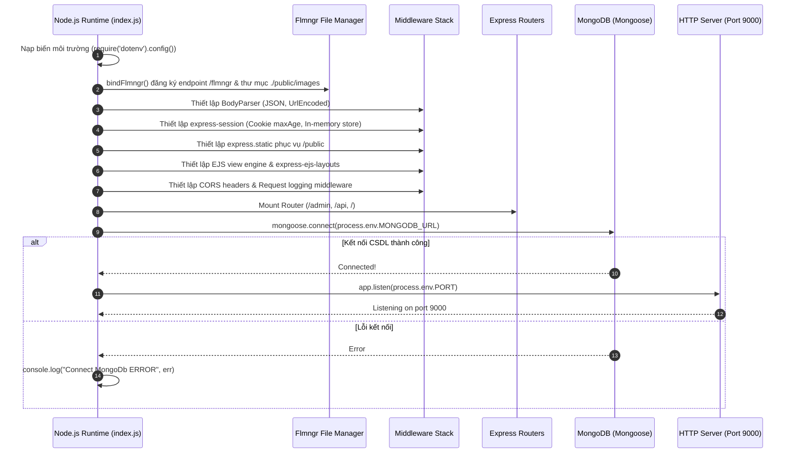

# Kiến Trúc Máy Chủ Backend (Backend Architecture)

## 1. Vòng đời khởi chạy ứng dụng (index.js Lifecycle)

Ứng dụng khởi động từ file `index.js` với quy trình tuần tự:

---

## 2. Chuỗi Middleware (Middleware Pipeline)

Express ứng dụng thứ tự middleware nghiêm ngặt:

1. **`bindFlmngr`**:
   - Được gắn ở tầng ứng dụng cấp cao nhất (`bindFlmngr({ app, urlFileManager: "/flmngr", urlFiles: "/images/", dirFiles: "./public/images" })`).
   - Xử lý các request quản lý tệp tin trực tiếp từ TinyMCE.
2. **Body Parsers**:
   - `express.json()` và `bodyParser.json()`: Giải mã các payload JSON trong request body.
   - `bodyParser.urlencoded({ extended: true })`: Giải mã dữ liệu form POST chuẩn HTML.
3. **Session Management**:
   - `express-session` sử dụng cookie có thời hạn (`maxAge: 8*60*60*1000` - 8 giờ).
   - *Lưu ý*: Cấu hình hiện dùng In-Memory Store mặc định (MemoryStore), không được khuyến cáo cho production vì sẽ mất session khi máy chủ khởi động lại hoặc chạy clustering qua PM2.
4. **Static File Serving**:
   - Phục vụ tệp tin tĩnh từ thư mục `public/` qua đường dẫn gốc.
5. **Template & View Engine**:
   - `expressLayouts`: Bật cơ chế kế thừa layout EJS.
   - `app.set('views', [...])`: Khai báo 3 thư mục tìm kiếm view: layouts, admin pages và client pages.
6. **CORS & Logging Middleware**:
   - Ghi log phương thức HTTP và params: `console.log(req.method, req.params)`.
   - Thiết lập header `Access-Control-Allow-Origin: *`.

---

## 3. Kiến trúc Điều hướng (Routing Architecture)

Hệ thống phân tách các tuyến đường độc lập trong thư mục `routes/`:

| Router | File định nghĩa | Mount Path | Mục đích |
| :--- | :--- | :--- | :--- |
| **Admin Router** | `routes/index.js` | `/admin` | Quản trị nội dung: đăng nhập, thêm/sửa/xóa bài viết, quản lý tag, widget components, media library |
| **Client Router** | `routes/client.js` | `/` | Giao diện công khai: trang chủ, chi tiết bài, lọc danh mục, tìm kiếm, danh mục dự án tương tác |
| **API Router** | `routes/api.js` | `/api` | REST Endpoint cung cấp dữ liệu JSON (`/api/datas`) |
| **Mail Router** | `routes/mail.js` | *(Chưa mount)* | Tuyến đường nhận gửi email lời chúc đám cưới (chưa được kích hoạt trong `index.js`) |

---

## 4. Tầng Điều Phối & Nghiệp Vụ (Controllers Layer)

### 4.1. `blogController.js` (Quản lý nghiệp vụ bài viết)
- `Func_Get_ALl_Post(p, query)`: Phân trang danh sách bài viết theo biến môi trường `PER_PAGE`.
  > [!WARNING]
  > Hiện tại hàm dùng `const count = await blogModel.find(query); count.length` để đếm tổng số bài viết. Khi số lượng bài viết lớn, việc fetch toàn bộ document vào RAM sẽ gây suy giảm hiệu năng nghiêm trọng. Cần chuyển sang `blogModel.countDocuments(query)`.
- `Func_Get_Post_By_Id(id)`: Lấy chi tiết bài viết theo ObjectId.
- `Func_Random_Post(callback, id)`: Sử dụng plugin `mongoose-simple-random` để lấy ngẫu nhiên 2 bài viết khác với bài hiện tại làm danh mục bài viết liên quan.
- `Func_Get_Random_Hint_Title()`: Sử dụng MongoDB Aggregation Pipeline (`$sample`, `$cond`, `$rand`) để lấy ngẫu nhiên 3 tiêu đề bài viết và 2 thẻ tag làm từ khóa gợi ý tự động cho thanh tìm kiếm.
- `Func_Create_Post(obj)` / `Func_Update_Post_By_Id(id, params)` / `Func_Delete_Post_By_Id(id)`: Thao tác thêm, sửa, xóa bài viết.
- `Func_Get_Unique_By_Field(fieldName)`: Sử dụng `blogModel.distinct()` để gom nhóm các chủ đề bài viết không trùng lặp (phục vụ mục Topic).

### 4.2. `clientController.js` (Điều phối hiển thị Client)
- `GetDataInHomePage()`: Hàm tổng hợp nạp song song toàn bộ dữ liệu widget cho sidebar trang chủ: danh sách tag, newsletter, bài viết phổ biến, danh mục topic và từ khóa gợi ý.
- `home(req, res)`: Hiển thị trang chủ kèm danh sách bài viết phân trang và widget sidebar.
- `detailPost(req, res)`: Hiển thị chi tiết nội dung bài viết, tác giả và bài viết liên quan.
- `tag(req, res)` & `filterTopic(req, res)`: Lọc bài viết theo thẻ tag hoặc chủ đề.
- `search(req, res)`: Tìm kiếm bài viết theo tiêu đề sử dụng RegExp case-insensitive (`$regex: title, $options: "i"`).
- `qrLove`, `fireworkLove`, `viewFormProjectLove`: Render form tạo các trang kỷ niệm tương tác.

### 4.3. `indexController.js` (Điều phối hiển thị Admin CMS)
- Đóng vai trò Controller trung tâm của trang quản trị.
- `login(req, res)` & `logout(req, res)`: Xử lý đăng nhập, cấp session `req.session.account` và hủy phiên.
- `home(req, res)`: Bảng điều khiển quản trị, kiểm tra `req.session?.account?.loggedin`.
- `addPost(req, res)` & `pageEdit(req, res)`: Quản lý giao diện tạo/sửa bài viết. Khi tạo bài viết thành công sẽ tự động gọi `_TAG_CON.Func_Increment_Quantity` để tăng số lượng đếm bài viết trong thẻ tag.
- `deletePost(req, res)`: Xóa bài viết và tự động gọi `_TAG_CON.Func_Decrement_Quantity` để giảm số lượng bài viết của thẻ tag tương ứng.
- `components(req, res)`: Quản lý cập nhật nội dung cho các widget singleton (About Author, Newsletter, Popular Articles, Portfolio).
- `viewUpload(req, res)`: Đọc toàn bộ tài nguyên ảnh từ Cloudinary CDN qua SDK để hiển thị trong Media Library.
- `getAllJsonData(req, res)`: Trả về JSON tổng hợp kinh nghiệm và dự án tĩnh phục vụ API.

### 4.4. `componentController.js` (Quản lý Component Singleton)
- Lưu trữ dữ liệu cấu hình các widget dưới dạng tài liệu đơn (Singleton Pattern).
- Sử dụng lệnh `findOneAndUpdate({}, params, { upsert: true, new: true, runValidators: true })` để cập nhật hoặc tự động tạo mới nếu collection chưa có bản ghi nào.

### 4.5. `projectLoveController.js` & `utils/ProjectLove/index.js`
- Xử lý các dự án kỷ niệm đa phương tiện (Love Projects).
- Lưu trữ nội dung chuỗi ký tự (`texts`), đường dẫn ảnh CDN trên Cloudinary (`images`), màu sắc (`color`), âm thanh (`music`) và mốc thời gian (`time`).

### 4.6. `mailController.js` (Gửi Email Lời Chúc)
- Tích hợp Nodemailer sử dụng dịch vụ SMTP (Sendinblue).
- Nhận thông điệp lời chúc đám cưới, lưu vào cơ sở dữ liệu `models/weddingWishesModel.js` và gửi email thông báo tới hòm thư cá nhân.

---

## 5. Xác thực và Phân quyền (Authentication & Security Review)

> [!CAUTION]
> **Các lỗ hổng bảo mật nghiêm trọng phát hiện qua phân tích mã nguồn:**
>
> 1. **Mật khẩu lưu dạng văn bản thuần (Plain-text Password)**:
>    - Tại `controllers/usersController.js#L12`, hàm `FUNC_LOGIN` truy vấn trực tiếp: `userModel.findOne({ username: obj.username, password: obj.password })`.
>    - Mặc dù thư viện `md5` có trong `package.json`, mật khẩu người dùng hiện không được băm (hash) trước khi lưu hoặc so sánh.
> 2. **Lệch cấu trúc Session giữa Controller và Middleware**:
>    - Trong `indexController.js#L164`, phiên đăng nhập lưu vào: `req.session.account = { loggedin: true, username, avatar }`.
>    - Trong `utils/middleware.js#L6`, hàm `checkLogin` lại kiểm tra: `if (req.session.user)`. Do đó middleware này sẽ luôn hiểu là chưa đăng nhập.
> 3. **Thiếu Middleware bảo vệ các Route Admin nhạy cảm**:
>    - Tại `routes/index.js`, các tuyến đường thao tác dữ liệu:
>      - `router.post('/add-post', index_Controller.addPost)`
>      - `router.post('/update-post', index_Controller.updatePost)`
>      - `router.post('/delete-post', index_Controller.deletePost)`
>      - `router.post('/add-tag', index_Controller.addTag)`
>      - `router.post('/update-tag', index_Controller.updateTag)`
>      - `router.post('/delete-tag', index_Controller.deleteTag)`
>    - **Không có bất kỳ middleware xác thực nào được áp dụng ở tầng router**. Bất kỳ ai gửi HTTP POST tới `/admin/delete-post?id=...` đều có thể xóa bài viết trong CSDL mà không cần đăng nhập.

---

## 6. Xử lý Lỗi (Error Handling)

1. **Controller Level**:
   - Tất cả các phương thức controller đều được bọc trong khối `try-catch`.
   - Khi xảy ra lỗi phía client router, ứng dụng chuyển hướng người dùng về trang 404 (`res.redirect('/page-404')`).
   - Lỗi được ghi ra console thông qua `console.error(error)`.
2. **Wildcard Fallback Route**:
   - Cuối `routes/client.js` có bộ lọc vét: `clientRouter.get('*', (req, res) => res.redirect('/page-404'))`.
3. **Thiếu sót kiến trúc**:
   - Chưa có Express Global Error Middleware `app.use((err, req, res, next) => { ... })` tập trung để bắt các lỗi runtime chưa xử lý hoặc log tập trung.

