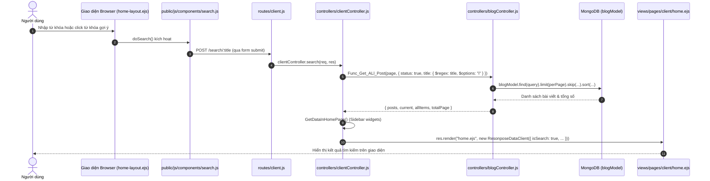
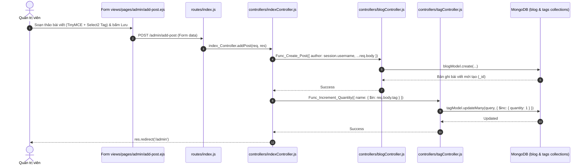
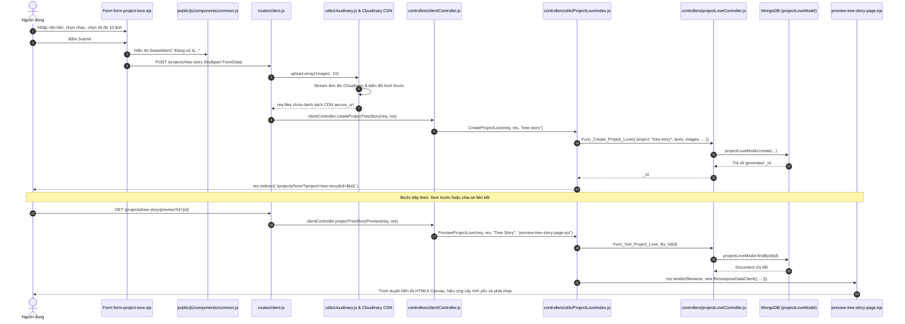
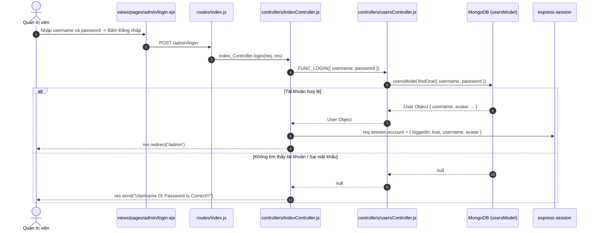
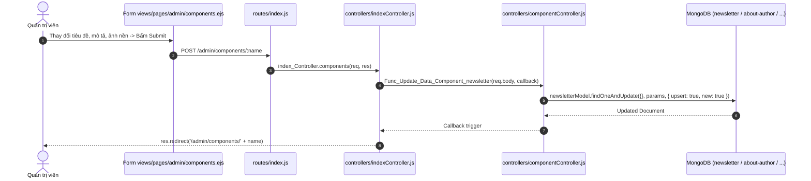

# Truy Vết Nghiệp Vụ End-to-End (Critical Business Flows)

Tài liệu này truy vết chi tiết các luồng nghiệp vụ quan trọng xuyên suốt từ giao diện người dùng (UI) $\to$ Tuyến đường (Route) $\to$ Bộ điều phối (Controller) $\to$ Logic nghiệp vụ (Business Service) $\to$ Cơ sở dữ liệu / Dịch vụ ngoài (Database / External Services) $\to$ Phản hồi kết quả (Response).

---

## 1. Luồng Tìm Kiếm Bài Viết Phía Client (Client Search Flow)

Người dùng tìm kiếm bài viết từ ô nhập liệu hoặc bấm chọn các từ khóa gợi ý động.

### Sơ đồ tuần tự:

### Chi tiết kỹ thuật dẫn chứng:
1. **Giao diện & Kích hoạt**: 
   - Phần tử ô tìm kiếm tại [views/layouts/home-layout.ejs#L54-L62](file:///d:/Project/Personal/Blog_Express_App/views/layouts/home-layout.ejs#L54-L62).
   - Hàm `doSearch()` trong [public/js/components/search.js#L133-L142](file:///d:/Project/Personal/Blog_Express_App/public/js/components/search.js#L133-L142) gán action `action="/search/${value}"` vào `.js-search-form` và gửi POST request.
2. **Tuyến đường**: 
   - [routes/client.js#L16](file:///d:/Project/Personal/Blog_Express_App/routes/client.js#L16): `clientRouter.post('/search/:title', clientController.search)`.
3. **Bộ điều phối & Logic**:
   - [controllers/clientController.js#L176-L208](file:///d:/Project/Personal/Blog_Express_App/controllers/clientController.js#L176-L208): hàm `search` trích xuất `title` từ `req.params`.
   - [controllers/blogController.js#L5-L24](file:///d:/Project/Personal/Blog_Express_App/controllers/blogController.js#L5-L24): hàm `Func_Get_ALl_Post` thực hiện truy vấn MongoDB với biểu thức chính quy `$regex` không phân biệt hoa thường `$options: "i"`.
4. **Kết xuất giao diện**:
   - Khởi tạo View Model `ResonposeDataClient` ([controllers/ResonposeDataClient.js](file:///d:/Project/Personal/Blog_Express_App/controllers/ResonposeDataClient.js)) và render [views/pages/client/home.ejs](file:///d:/Project/Personal/Blog_Express_App/views/pages/client/home.ejs) kèm partial [views/components/c_list-post.ejs](file:///d:/Project/Personal/Blog_Express_App/views/components/c_list-post.ejs).

---

## 2. Luồng Tạo Bài Viết Mới & Tự Động Cập Nhật Thẻ Tag (Admin Post Creation)

Quản trị viên soạn thảo và xuất bản bài viết mới; hệ thống tự động đồng bộ biến đếm bài viết trong thẻ tag.

### Sơ đồ tuần tự:

### Chi tiết kỹ thuật dẫn chứng:
1. **Giao diện**:
   - Form soạn thảo tại [views/pages/admin/add-post.ejs](file:///d:/Project/Personal/Blog_Express_App/views/pages/admin/add-post.ejs) tích hợp TinyMCE và Select2 ([public/js/admin.js#L35-L58](file:///d:/Project/Personal/Blog_Express_App/public/js/admin.js#L35-L58)).
2. **Tuyến đường**:
   - [routes/index.js#L25](file:///d:/Project/Personal/Blog_Express_App/routes/index.js#L25): `router.post('/add-post', index_Controller.addPost)`.
3. **Thực thi Controller & Ghi CSDL**:
   - [controllers/indexController.js#L59-L85](file:///d:/Project/Personal/Blog_Express_App/controllers/indexController.js#L59-L85): `addPost(req, res)`:
     - Gọi `_BLOG_CON.Func_Create_Post` ([controllers/blogController.js#L83-L95](file:///d:/Project/Personal/Blog_Express_App/controllers/blogController.js#L83-L95)) tạo document trong `blogModel`.
     - Sau khi tạo bài thành công, gọi `_TAG_CON.Func_Increment_Quantity` ([controllers/tagController.js#L24-L26](file:///d:/Project/Personal/Blog_Express_App/controllers/tagController.js#L24-L26)) thực thi lệnh MongoDB `tagModel.updateMany({ name: { "$in": req.body.tag } }, { $inc: { 'quantity': 1 } })`.
4. **Phản hồi**: Chuyển hướng người dùng về trang danh sách bài viết `/admin`.

---

## 3. Luồng Khởi Tạo & Xem Trước Dự Án Kỷ Niệm (Interactive Love Projects Flow)

Người dùng nhập thông điệp, chọn màu chữ, âm thanh và tải lên tối đa 10 hình ảnh để tạo trang hoạt họa kỷ niệm tương tác (Ví dụ: `Tree Story`).

### Sơ đồ tuần tự:

### Chi tiết kỹ thuật dẫn chứng:
1. **Giao diện & Xử lý Client**:
   - Form tại [views/pages/client/projects/form-project-love.ejs](file:///d:/Project/Personal/Blog_Express_App/views/pages/client/projects/form-project-love.ejs).
   - [public/js/components/common.js#L10-L24](file:///d:/Project/Personal/Blog_Express_App/public/js/components/common.js#L10-L24): Bắt submit form, hiển thị `Swal.showLoading()`, gộp chuỗi các ô input vào `js-input-texts`.
2. **Middleware Upload**:
   - [routes/client.js#L22](file:///d:/Project/Personal/Blog_Express_App/routes/client.js#L22): Sử dụng `upload.array('images', 10)`.
   - [utils/cloudinary.js#L15-L45](file:///d:/Project/Personal/Blog_Express_App/utils/cloudinary.js#L15-L45): Cấu hình Multer Cloudinary Storage với thư mục `uploads`, giới hạn dung lượng 10MB, tự động nén và biến đổi ảnh `crop: 'limit', quality: 'auto'`.
3. **Thực thi Controller**:
   - [controllers/clientController.js#L383-L389](file:///d:/Project/Personal/Blog_Express_App/controllers/clientController.js#L383-L389) gọi `CreateProjectLove` trong [controllers/utils/ProjectLove/index.js#L19-L43](file:///d:/Project/Personal/Blog_Express_App/controllers/utils/ProjectLove/index.js#L19-L43).
   - [controllers/projectLoveController.js#L7-L11](file:///d:/Project/Personal/Blog_Express_App/controllers/projectLoveController.js#L7-L11): Lưu thông tin vào `projectLoveModel` ([models/projectLoveModel.js](file:///d:/Project/Personal/Blog_Express_App/models/projectLoveModel.js)).
4. **Hiển thị Preview**:
   - [controllers/utils/ProjectLove/index.js#L45-L75](file:///d:/Project/Personal/Blog_Express_App/controllers/utils/ProjectLove/index.js#L45-L75): `PreviewProjectLove` truy vấn CSDL theo ID và render [views/pages/client/projects/preview-tree-story-page.ejs](file:///d:/Project/Personal/Blog_Express_App/views/pages/client/projects/preview-tree-story-page.ejs).

---

## 4. Luồng Xác Thực Quản Trị Viên (Admin Authentication Flow)

### Sơ đồ tuần tự:

### Chi tiết kỹ thuật dẫn chứng:
1. **Tuyến đường**: [routes/index.js#L11-L12](file:///d:/Project/Personal/Blog_Express_App/routes/index.js#L11-L12).
2. **Controller**: [controllers/indexController.js#L149-L180](file:///d:/Project/Personal/Blog_Express_App/controllers/indexController.js#L149-L180).
3. **Model & CSDL**: [controllers/usersController.js#L10-L16](file:///d:/Project/Personal/Blog_Express_App/controllers/usersController.js#L10-L16) truy vấn `userModel.findOne({ username: obj.username, password: obj.password })`.
4. **Đánh giá**: Mật khẩu đang được đối chiếu ở dạng plain text, cần mã hóa băm mật khẩu (bcrypt/argon2 hoặc md5 kèm salt) và điều chỉnh thông báo phản hồi khi đăng nhập sai.

---

## 5. Luồng Cập Nhật Cấu Hình Widget (CMS Widget Singleton Update Flow)

Quản trị viên cập nhật thông tin widget (ví dụ: `newsletter` hoặc `about_author`).

### Sơ đồ tuần tự:

### Chi tiết kỹ thuật dẫn chứng:
1. **Tuyến đường**: [routes/index.js#L45-L46](file:///d:/Project/Personal/Blog_Express_App/routes/index.js#L45-L46): `router.post('/components/:name', index_Controller.components)`.
2. **Thực thi Controller**:
   - [controllers/indexController.js#L256-L284](file:///d:/Project/Personal/Blog_Express_App/controllers/indexController.js#L256-L284): hàm `components` gọi hàm động theo tên component: `_COMP_CON['Func_Update_Data_Component_' + name](req.body, callback)`.
   - [controllers/componentController.js#L11-L28](file:///d:/Project/Personal/Blog_Express_App/controllers/componentController.js#L11-L28): sử dụng tùy chọn `{ upsert: true, new: true, runValidators: true }` để đảm bảo luôn cập nhật hoặc tạo mới 1 bản ghi duy nhất.

