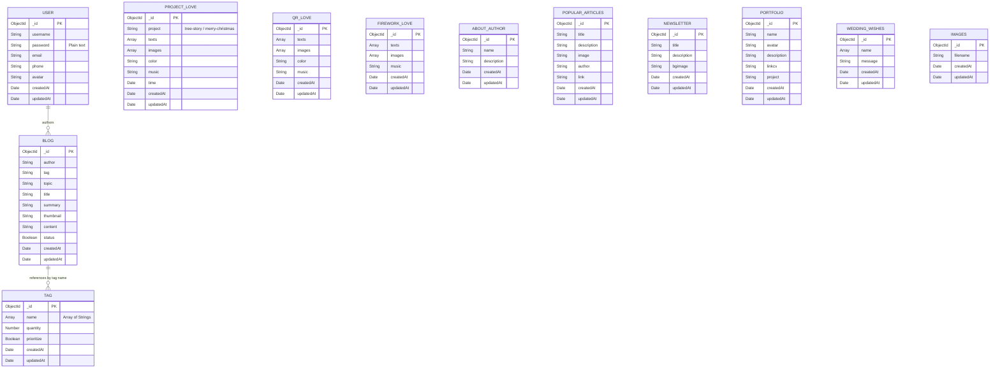

# Mô Hình Dữ Liệu & Cơ Sở Dữ Liệu (Data Model Specification)

Tài liệu này chi tiết hóa toàn bộ các lược đồ dữ liệu (Schemas), bộ sưu tập (Collections), chỉ mục (Indexes) và mối quan hệ logic trong MongoDB thông qua Mongoose ODM.

---

## 1. Sơ đồ Thực thể - Mối quan hệ Logic (Entity Relationship Diagram)

---

## 2. Chi tiết các Bộ sưu tập & Lược đồ (Schema Specifications)

### 2.1. Collection: `blog` ([models/blogModel.js](file:///d:/Project/Personal/Blog_Express_App/models/blogModel.js))
Lưu trữ các bài viết trên hệ thống blog.
- **Plugins tích hợp**: `mongoose-simple-random` (hỗ trợ hàm `findRandom` để truy vấn bài viết liên quan).
- **Cấu trúc trường**:
  | Trường | Kiểu dữ liệu | Mặc định | Bắt buộc | Ghi chú |
  | :--- | :--- | :--- | :--- | :--- |
  | `_id` | `ObjectId` | Tự sinh | Có | Khóa chính MongoDB |
  | `author` | `String` | `''` | Có | Tên tài khoản tác giả tạo bài |
  | `tag` | `String` | `''` | Không | Danh sách tag lưu dạng chuỗi ngăn cách bằng dấu phẩy |
  | `topic` | `String` | `''` | Không | Chuyên đề phân loại bài viết |
  | `title` | `String` | `''` | Có | Tiêu đề bài viết |
  | `summary` | `String` | `''` | Không | Tóm tắt ngắn hiển thị trên danh sách |
  | `thumbnail` | `String` | `''` | Không | Đường dẫn URL ảnh đại diện bài viết |
  | `content` | `String` | `''` | Không | Nội dung chi tiết định dạng HTML (từ TinyMCE) |
  | `status` | `Boolean` | `true` | Không | Trạng thái hiển thị (`true`: công khai, `false`: ẩn) |
  | `createdAt` | `Date` | Tự sinh | - | Tự động sinh qua `{ timestamps: true }` |
  | `updatedAt` | `Date` | Tự sinh | - | Tự động sinh qua `{ timestamps: true }` |

---

### 2.2. Collection: `tags` ([models/tagsModel.js](file:///d:/Project/Personal/Blog_Express_App/models/tagsModel.js))
Lưu trữ thông tin các thẻ tag phân loại bài viết.
- **Chỉ mục (Indexes)**: `{ name: 1 }`
- **Cấu trúc trường**:
  | Trường | Kiểu dữ liệu | Mặc định | Bắt buộc | Ghi chú |
  | :--- | :--- | :--- | :--- | :--- |
  | `name` | `[String]` | - | Có | Mảng chứa chuỗi tên thẻ (được định nghĩa `[{ type: String, required: true }]`) |
  | `quantity` | `Number` | `0` | Không | Số lượng bài viết đang gắn thẻ này (được tăng/giảm tự động) |
  | `prioritize` | `Boolean` | `0` | Không | Đánh dấu thẻ ưu tiên hiển thị nổi bật |

---

### 2.3. Collection: `users` ([models/usersModel.js](file:///d:/Project/Personal/Blog_Express_App/models/usersModel.js))
Lưu trữ tài khoản quản trị viên và người dùng hệ thống.
- **Chỉ mục (Indexes)**: `{ email: 1 }`
- **Cấu trúc trường**:
  | Trường | Kiểu dữ liệu | Mặc định | Bắt buộc | Ghi chú |
  | :--- | :--- | :--- | :--- | :--- |
  | `username` | `String` | `''` | Không | Tên tài khoản đăng nhập |
  | `password` | `String` | `''` | Không | Mật khẩu (hiện lưu dạng **Plain text**, cần mã hóa) |
  | `email` | `String` | `''` | Không | Email liên lạc |
  | `phone` | `String` | `''` | Không | Số điện thoại |
  | `avatar` | `String` | `''` | Không | Đường dẫn ảnh đại diện |

---

### 2.4. Phân hệ Dự án Kỷ niệm & Trải nghiệm (Love & Event Projects)

#### A. Collection: `project-love` ([models/projectLoveModel.js](file:///d:/Project/Personal/Blog_Express_App/models/projectLoveModel.js))
Dùng cho 2 dự án: `tree-story` (cây tình yêu) và `merry-christmas` (giáng sinh).
- **Chỉ mục (Indexes)**: `{ texts: 1 }`
- **Cấu trúc trường**:
  - `project`: `String` (Bắt buộc) - Xác định loại dự án (`tree-story` hoặc `merry-christmas`).
  - `texts`: `[String]` (Bắt buộc) - Danh sách các thông điệp tình cảm / lời chúc.
  - `images`: `[String]` (Tùy chọn) - Danh sách đường dẫn ảnh lưu trên Cloudinary CDN.
  - `color`: `String` (Tùy chọn) - Mã màu hex của chữ hiển thị.
  - `music`: `String` (Tùy chọn) - Tên hoặc đường dẫn file âm thanh nền.
  - `time`: `Date` (Tùy chọn) - Mốc thời gian kỷ niệm (ngày yêu nhau / ngày cưới).

#### B. Collection: `qr-love` ([models/qrLoveModel.js](file:///d:/Project/Personal/Blog_Express_App/models/qrLoveModel.js))
Dành cho trang tạo thông điệp mã QR Tình yêu.
- **Chỉ mục (Indexes)**: `{ texts: 1 }`
- **Cấu trúc trường**: `texts` (`[String]`), `images` (`[String]`), `color` (`String`), `music` (`String`).

#### C. Collection: `firework-love` ([models/fireworkLoveModel.js](file:///d:/Project/Personal/Blog_Express_App/models/fireworkLoveModel.js))
Dành cho trang hiệu ứng pháo hoa kết hợp ảnh và âm thanh.
- **Chỉ mục (Indexes)**: `{ texts: 1 }`
- **Cấu trúc trường**: `texts` (`[String]`), `images` (`[String]`), `music` (`String`).

---

### 2.5. Phân hệ Cấu hình Widget (CMS Component Singletons)
Các bộ sưu tập này tuân theo mô hình Document Singleton, chỉ duy trì 1 bản ghi duy nhất được cập nhật qua cơ chế `upsert`:

1. **`about-author`** ([models/aboutAuthorModel.js](file:///d:/Project/Personal/Blog_Express_App/models/aboutAuthorModel.js)):
   - `name`: `String` (Tên tác giả)
   - `description`: `String` (Mô tả tiểu sử ngắn)
2. **`newsletter`** ([models/newsletterModel.js](file:///d:/Project/Personal/Blog_Express_App/models/newsletterModel.js)):
   - `title`: `String` (Tiêu đề khối nhận tin)
   - `description`: `String` (Nội dung giới thiệu)
   - `bgimage`: `String` (Ảnh nền khối)
3. **`popular-articles`** ([models/popularArticlesModel.js](file:///d:/Project/Personal/Blog_Express_App/models/popularArticlesModel.js)):
   - `title`: `String`, `description`: `String`, `image`: `String`, `author`: `String`, `link`: `String`
4. **`portfolio`** ([models/portfolioModel.js](file:///d:/Project/Personal/Blog_Express_App/models/portfolioModel.js)):
   - `name`: `String`, `avatar`: `String`, `description`: `String`, `linkcv`: `String`, `project`: `String`

---

### 2.6. Các Collection Bổ trợ khác
1. **`wedding-wishes`** ([models/weddingWishesModel.js](file:///d:/Project/Personal/Blog_Express_App/models/weddingWishesModel.js)):
   - Lưu trữ lời chúc: `name` (`[String]`), `message` (`String`). Chỉ mục `{ name: 1 }`.
2. **`images`** ([models/imagesModel.js](file:///d:/Project/Personal/Blog_Express_App/models/imagesModel.js)):
   - Quản lý tệp tin tải lên: `filename` (`String`). Chỉ mục `{ filename: 1 }`.

---

## 3. Đánh giá Thiết kế CSDL & Điểm Bất Thường (Schema Anomalies)

> [!NOTE]
> 1. **Kiểu dữ liệu mảng không đồng nhất**:
>    - Trong `models/tagsModel.js`, trường `name` được khai báo là một mảng `[{ type: String, required: true }]`, trong khi khi query `_TAG_CON.Func_Increment_Quantity`, code thực hiện: `{ name: { "$in": req.body.tag } }`. Điều này hoạt động do cơ chế unwrap mảng tự động của MongoDB, nhưng khai báo chính xác hơn nên là kiểu `String` duy nhất.
>    - Tương tự, `weddingWishesModel.name` cũng được khai báo dạng mảng `[String]` dù thực tế nhận tên của một cá nhân gửi lời chúc.
> 2. **Đồng bộ số lượng bài viết (Tag Quantity Denormalization)**:
>    - Hệ thống lưu trường `quantity` trong `tags` và tự tăng/giảm (`Func_Increment_Quantity`, `Func_Decrement_Quantity`) khi tạo/xóa bài viết. Nếu xảy ra lỗi giữa chừng trong giao dịch, số lượng này có thể bị lệch so với số bài viết thực tế có gắn tag đó.

