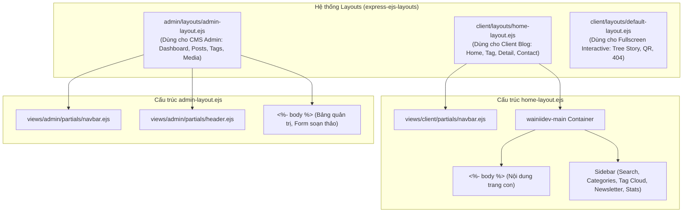

# Kiến Trúc Giao Diện Phía Client (Frontend Architecture)

## 1. Mô hình kiến trúc giao diện
Frontend của hệ thống được xây dựng theo mô hình **Multi-Page Application (MPA)** với kỹ thuật **Server-Side Rendering (SSR)** thông qua thư viện `ejs` và `express-ejs-layouts`.

Toàn bộ HTML được máy chủ Node.js kết xuất kèm dữ liệu động trước khi gửi về cho trình duyệt. Phía trình duyệt sau đó tải các tài nguyên tĩnh (CSS, Web Fonts) và thực thi JavaScript (ES Module kết hợp jQuery) để bổ sung các hiệu ứng tương tác:
- Gợi ý từ khóa động (Typing Animation).
- Băng chuyền trình chiếu bài viết/danh mục (Slick Carousel & Owl Carousel).
- Tương tác với form tạo dự án kỷ niệm (SweetAlert2, dynamic input fields).
- Trình soạn thảo văn bản giàu tính năng TinyMCE kèm File Manager trong Admin.

---

## 2. Hệ thống Layouts (views/client/layouts/ & views/admin/layouts/)

Hệ thống sử dụng 3 layout chính phục vụ từng ngữ cảnh chuyên biệt:



### 2.1. `home-layout.ejs` (Layout Blog chính - `views/client/layouts/`)
- **Đặc điểm**: Bố cục 2 cột (Cột chính hiển thị bài viết, Cột phụ bên phải chứa widget thanh tìm kiếm, danh mục `categories`, đám mây thẻ `tag-cloud`, đăng ký nhận tin `newsletter` và thống kê `statistical`).
- **Cờ điều khiển giao diện**:
  - `fullLayout`: Nếu `true`, hiển thị bố cục 2 cột. Nếu `false`, chỉ render `<%- body %>` (dành cho trang giới thiệu hoặc danh mục toàn trang).
  - `isHideSidebar`: Ẩn cột sidebar bên phải khi xem chi tiết bài viết (`detail-post.ejs`) để dành không gian tối đa cho nội dung bài đọc.
- **Tải trước (Preloader)**: Tích hợp hiệu ứng SVG xoay (`#ftco-loader`) khi tải trang.

### 2.2. `admin-layout.ejs` (Layout Trang Quản Trị - `views/admin/layouts/`)
- **Đặc điểm**: Bố cục Dashboard hiện đại với sidebar điều hướng dọc (`views/admin/partials/navbar.ejs`), thanh header hiển thị profile và avatar (`views/admin/partials/header.ejs`).
- **Nạp style linh hoạt**: Cờ `useStyleClient` cho phép nhúng kèm `main.css` của phía client khi xem trước hoặc chỉnh sửa các component của client ngay trong admin.
- **Thư viện tích hợp**: Nạp TinyMCE, Flmngr JS SDK, Highlight.js và Select2 qua `views/admin/partials/block-script.ejs`.

### 2.3. `default-layout.ejs` (Layout Toàn Màn Hình - `views/client/layouts/`)
- **Đặc điểm**: Bố cục không có thanh điều hướng hay sidebar, sử dụng class `fullscreen-layout`.
- **Mục đích**: Dành riêng cho trang thông báo lỗi 404 (`page-404.ejs`) và các trang trải nghiệm tương tác toàn màn hình (Preview Tree Story, QR Code Love, Firework Love).

---

## 3. Bản đồ các thành phần giao diện (Component Hierarchy)

### 3.1. Reusable Partials Phía Client (`views/client/partials/`)
- `navbar.ejs`: Thanh menu điều hướng chính của Client blog.
- `list-post.ejs`: Danh sách bài viết phía client kèm ảnh thumbnail, tiêu đề, ngày tháng, liên kết đọc chi tiết.
- `topic.ejs`: Băng chuyền hiển thị các chủ đề (Topic) trên trang chủ.
- `categories.ejs`: Danh sách danh mục bài viết lấy từ trường `topic` trong cơ sở dữ liệu.
- `tag-cloud.ejs`: Danh sách các thẻ tag được định dạng dạng đám mây từ khóa.
- `newsletter.ejs`: Widget kêu gọi người dùng đăng ký nhận bản tin qua email.
- `about-author.ejs`: Khối giới thiệu ngắn về tác giả kèm avatar hiển thị ở cuối bài viết chi tiết.
- `related-post.ejs`: Khối bài viết liên quan ngẫu nhiên.
- `popular-articles.ejs`: Băng chuyền bài viết nổi bật.
- `portfolio.ejs`: Khối tóm tắt hồ sơ tác giả.
- `statistical.ejs`: Thống kê số lượng bài viết và chuyên mục.
- `archives.ejs`: Lưu trữ bài viết theo thời gian.
- `no-result.ejs`: Khối hiển thị khi không tìm thấy kết quả.

### 3.2. Reusable Partials Phía Admin (`views/admin/partials/`)
- `header.ejs`: Header admin hiển thị thông tin tài khoản, breadcrumb và nút hành động.
- `navbar.ejs`: Menu thanh bên của Admin CMS (Liên kết tới Posts, Tags, Components, Media).
- `meta.ejs`: Khai báo thẻ meta, favicon và nạp stylesheets admin.
- `block-script.ejs`: Nạp các thư viện JavaScript hỗ trợ quản trị (TinyMCE, Select2, Highlight.js).
- `blog-table.ejs`: Bảng dữ liệu quản lý bài viết trong Admin (tiêu đề, ngày tạo, thẻ tag, nút Sửa/Xóa).
- `tag-table.ejs`: Bảng dữ liệu quản lý danh sách thẻ tag.
- `media-grid.ejs`: Lưới hiển thị danh sách hình ảnh trong thư viện media.
- `stats.ejs`: Khối thống kê số liệu tổng quan.

### 3.3. Partials Dùng Chung (`views/shared/`)
- `pagination.ejs`: Thanh phân trang đa năng dùng chung cho cả Client và Admin CMS.

---

## 4. Kiến trúc Client-Side JavaScript

Mã nguồn JavaScript phía client được phân tách theo module rõ ràng tại thư mục `public/js/`:

### 4.1. Entry Point Module (`public/js/app.js`)
Sử dụng ES Module gốc của trình duyệt (`type="module"`), đóng vai trò tập hợp các component xử lý giao diện:
```javascript
import './components/navbar.js';
import './components/blog.js';
import './components/carousel.js';
import './components/search.js';
import './components/common.js';
import './components/evenlope.js';
```

### 4.2. Chi tiết các module tính năng (`public/js/components/`)
1. **`search.js` (Tìm kiếm và Gợi ý động)**:
   - Đọc danh sách gợi ý từ thuộc tính `data-hints` trong thẻ HTML `#hintList` (dữ liệu truyền từ backend qua `hints.join('|')`).
   - Khởi tạo vòng lặp mô phỏng gõ chữ (`typeNextSuggestion`) và xóa chữ (`stepErase`) tự động trên ô placeholder.
   - Khi người dùng bấm vào một nút gợi ý hoặc nhập từ khóa rồi nhấn Enter/Blur/Search Icon, hàm `doSearch()` sẽ gán action vào form (`/search/${keyword}`) và submit POST request về server.
2. **`common.js` (Xử lý Form Dự án Tình yêu & Đa phương tiện)**:
   - Bắt sự kiện nộp form tạo dự án tương tác (`data-form-create`).
   - Sử dụng **SweetAlert2** (`Swal.fire`) hiển thị hộp thoại loading "Đang xử lý ... Vui lòng chờ trong giây lát" để người dùng không bấm gửi lặp lại trong lúc tải ảnh lên Cloudinary.
   - Quản lý thêm/bớt ô nhập text động (`addInput`, `removeInput`), gộp các chuỗi vào thẻ input ẩn `js-input-texts` ngăn cách bằng dấu phẩy.
   - Tự động copy liên kết xem trước (`copyLink`) bằng Clipboard API.
3. **`blog.js` (Xử lý fallback hình ảnh bài viết)**:
   - Duyệt qua các bài viết `.js-blog-entry`, đọc thuộc tính `data-src-image`.
   - Gán cờ `onerror` để tự động thay thế bằng `/images/default-post.png` nếu link ảnh bị hỏng.
4. **`carousel.js` (Hiệu ứng trình chiếu)**:
   - Khởi tạo Slick Slider cho class `.js-topic-carousel` với tính năng `variableWidth: true`, `autoplay: true`.
5. **`navbar.js` (Active menu)**:
   - Phân tích `window.location.pathname` và tự động gắn class `active` vào menu item tương ứng.

### 4.3. Script Quản trị (`public/js/admin.js`)
- **TinyMCE + Flmngr Integration**:
  - Khởi tạo TinyMCE phiên bản 5 trên textarea `#editor-content`.
  - Tích hợp plugin `@flmngr` kết nối tới backend `/flmngr` và thư mục static `./public/images` để chọn/tải ảnh trực tiếp vào nội dung bài viết.
  - Tích hợp nút chọn ảnh bìa đại diện (`#thumbnail-btn`) kết nối với Flmngr API.
- **Highlight & Format Code**:
  - Sử dụng thư viện `html_beautify` và `hljs.highlightAll()` để tự động thụt dòng và tô màu cú pháp các khối mã hiển thị.
- **Select2 Tagging**:
  - Gắn Select2 cho dropdown chọn thẻ tag `#select-tag`.

---

## 5. Kiến trúc Styling và CSS

- Dự án sử dụng hệ thống CSS xây dựng sẵn dựa trên Bootstrap 4, FontAwesome 5, Flaticon và Icomoon.
- **Sass / SCSS**:
  - Mã nguồn SCSS được lưu tại `public/css/components/add-post.scss` và `public/css/components/blog-table.scss`.
  - Được biên dịch ra các file CSS tương ứng kèm source map (`.css.map`).
  - *Lưu ý về cấu hình build*: Lệnh `npm run sass` trong `package.json` hiện đang cấu hình theo đường dẫn `sass --watch assets/css/:public/css/`. Tuy nhiên thư mục `assets/` không tồn tại ở thư mục gốc, cần cập nhật đường dẫn biên dịch cho chính xác (xem tài liệu `setup-guide.md`).

