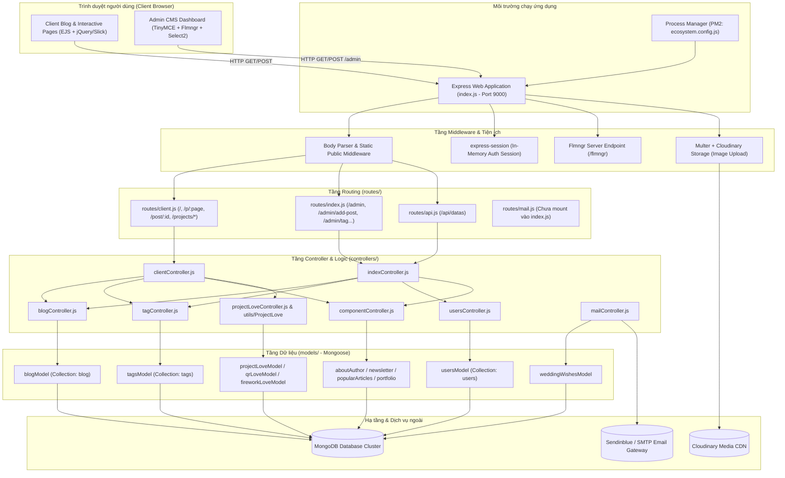

# Tổng Quan Kiến Trúc Hệ Thống (System Architecture Overview)

## 1. Giới thiệu dự án
Dự án **Blog Express App** (tên nội bộ trong package.json: `build_project_anonystick`) là một ứng dụng web Full-stack theo mô hình Monolith (MPA - Multi-Page Application) được xây dựng trên nền tảng **Node.js**, **Express.js**, **MongoDB** (Mongoose ODM) và **EJS Template Engine**.

Ứng dụng kết hợp giữa:
1. **Personal Blog & Portfolio Platform**: Giới thiệu thông tin cá nhân, kinh nghiệm làm việc, kỹ năng, các bài viết công nghệ và danh mục chuyên đề.
2. **Admin CMS (Content Management System)**: Bảng quản trị cho phép soạn thảo bài viết bằng TinyMCE kết hợp Flmngr File Manager, quản lý tag, cập nhật các widget hiển thị (About Author, Newsletter, Popular Articles, Portfolio) và quản lý thư viện hình ảnh qua Cloudinary.
3. **Interactive Viral / Holiday Experiences (Love & Event Projects)**: Phân hệ tạo trang tương tác đa phương tiện (Tree Story Love, Merry Christmas, QR Love, Fireworks Love) cho phép người dùng nhập thông điệp, hình ảnh, âm nhạc và tạo trang kỷ niệm chia sẻ qua URL.

---

## 2. Công nghệ chủ đạo (Technology Stack)

| Lớp (Layer) | Công nghệ / Thư viện | Phiên bản | Mục đích sử dụng |
| :--- | :--- | :--- | :--- |
| **Runtime** | Node.js | `>=18.x` (khuyến nghị `18.14.0+`) | Môi trường thực thi JavaScript phía máy chủ |
| **Backend Framework** | Express.js | `^4.18.2` | Web framework xử lý routing, middleware, REST endpoint |
| **Process Manager** | PM2 | - (`ecosystem.config.js`) | Quản lý tiến trình trong môi trường production |
| **Database** | MongoDB | `>=4.4` | Cơ sở dữ liệu NoSQL lưu trữ tài liệu |
| **Database ODM** | Mongoose | `^5.9.9` | Object Data Modeling (Schema, validation, middleware, query) |
| **View Engine** | EJS & express-ejs-layouts | `^3.0.2` & `^2.5.1` | Server-Side Rendering (SSR) giao diện HTML đa trang |
| **Session & Auth** | express-session | `^1.17.3` | Quản lý phiên đăng nhập admin (Cookie-based session in-memory) |
| **File Storage & CDN**| Cloudinary & Multer | `^1.41.0` & `^1.4.5-lts.1` | Upload ảnh multipart, lưu trữ Cloudinary CDN, biến đổi kích thước |
| **File Manager CMS** | `@flmngr/flmngr-server-node-express` | `^1.5.1` | Tích hợp trình quản lý tệp tin trực quan cho TinyMCE trong Admin |
| **Email Service** | Nodemailer | `^6.9.16` | Gửi email thông báo (tích hợp SMTP Sendinblue) |
| **CSS Preprocessor** | Sass (Dart Sass) | `^1.62.1` | Biên dịch style SCSS sang CSS |
| **Client UI Libraries** | jQuery, Bootstrap 4, Slick, Owl Carousel, SweetAlert2 | Native CDN / Vendor | Xử lý hiệu ứng giao diện, carousel, modal thông báo |

---

## 3. Sơ đồ kiến trúc tổng thể (System Architecture Diagram)



---

## 4. Cấu trúc thư mục dự án (Repository Directory Structure)

```text
Blog_Express_App/
├── .gitignore                     # Cấu hình bỏ qua tệp tin Git (.env, node_modules)
├── ecosystem.config.js            # Cấu hình PM2 cho môi trường Production (Port 9000)
├── env.example                    # Mẫu khai báo biến môi trường (Environment Variables)
├── index.js                       # Điểm khởi chạy máy chủ Express và kết nối MongoDB
├── package.json                   # Danh mục dependencies, engine node 18.x và scripts
├── README.md                      # Hướng dẫn khởi chạy dự án cơ bản
├── api/                           # Dữ liệu JSON tĩnh cho hồ sơ cá nhân
│   ├── experiences.js             # Danh sách kinh nghiệm làm việc mẫu
│   ├── index.js                   # Điểm gộp dữ liệu api tĩnh
│   └── projects.js                # Danh sách dự án mẫu
├── config/                        # Cấu hình tĩnh
│   ├── constant.js                # Hằng số (SUCCESS, PORT 9000)
│   ├── db.config.js               # Placeholder cấu hình DB
│   └── index.js                   # Cấu hình port mặc định
├── controllers/                   # Tầng điều phối xử lý logic ứng dụng
│   ├── blogController.js          # CRUD bài viết, phân trang, gợi ý từ khóa, bài liên quan
│   ├── clientController.js        # Điều phối giao diện người dùng, tìm kiếm, dự án tương tác
│   ├── componentController.js     # Quản lý widget trang chủ (newsletter, popular, portfolio...)
│   ├── indexController.js         # Điều phối Admin CMS, xác thực session, media library
│   ├── mailController.js          # Xử lý gửi email qua Nodemailer và lưu lời chúc
│   ├── projectLoveController.js   # Xử lý dữ liệu các trang kỷ niệm tương tác (Love Projects)
│   ├── ResonposeDataClient.js     # DTO / View Model chuẩn hóa dữ liệu gửi sang client view
│   ├── tagController.js           # CRUD thẻ tag và tăng/giảm số lượng bài viết theo tag
│   ├── usersController.js         # Xử lý đăng ký / kiểm tra đăng nhập tài khoản admin
│   └── utils/
│       └── ProjectLove/
│           └── index.js           # Helpers dùng chung cho khởi tạo và preview Love Project
├── models/                        # Mongoose Schemas & Models định nghĩa cấu trúc dữ liệu
│   ├── aboutAuthorModel.js        # Schema thông tin tác giả
│   ├── blogModel.js               # Schema bài viết blog (+ plugin mongoose-simple-random)
│   ├── fireworkLoveModel.js       # Schema dự án hiệu ứng pháo hoa
│   ├── imagesModel.js             # Schema thông tin hình ảnh
│   ├── newsletterModel.js         # Schema widget đăng ký bản tin
│   ├── popularArticlesModel.js    # Schema danh mục bài viết phổ biến
│   ├── portfolioModel.js          # Schema hồ sơ cá nhân
│   ├── projectLoveModel.js        # Schema dự án Tree Story & Merry Christmas
│   ├── qrLoveModel.js             # Schema dự án QR Code Love
│   ├── tagsModel.js               # Schema thẻ bài viết có đánh index
│   ├── usersModel.js              # Schema người dùng / quản trị viên
│   └── weddingWishesModel.js      # Schema lưu trữ lời chúc đám cưới
├── public/                        # Tài nguyên tĩnh phục vụ trực tiếp cho trình duyệt
│   ├── css/                       # File CSS đã biên dịch và source SCSS
│   │   └── components/            # SCSS cho bảng bài viết và form thêm bài viết
│   ├── fonts/                     # Web fonts biểu tượng (icomoon, ionicons, Flaticon...)
│   ├── images/                    # Hình ảnh tĩnh, avatar, thumbnail mặc định, tech skins
│   └── js/                        # Mã JavaScript chạy phía client
│       ├── admin.js               # Script trang quản trị (TinyMCE, Flmngr, Select2)
│       ├── app.js                 # Entry point ES Module phía client
│       ├── main.js                # Hiệu ứng chung giao diện blog
│       ├── components/            # Module tính năng (search, blog, navbar, carousel...)
│       └── plugin/                # Thư viện ngoài (jQuery, AOS, Slick, Waypoints...)
├── routes/                        # Khai báo đường dẫn HTTP Express Router
│   ├── api.js                     # Tuyến đường API JSON (/api/datas)
│   ├── client.js                  # Tuyến đường client blog và dự án tương tác
│   ├── index.js                   # Tuyến đường Admin CMS (/admin/*)
│   └── mail.js                    # Tuyến đường gửi email (hiện chưa mount)
├── utils/                         # Tiện ích bổ trợ backend
│   ├── cloudinary.js              # Cấu hình SDK Cloudinary v2 và Multer Cloudinary Storage
│   ├── index.js                   # Hàm tiện ích kiểm tra thiếu thuộc tính
│   └── middleware.js              # Middleware kiểm tra đăng nhập (checkLogin)
└── views/                         # Giao diện EJS Template
    ├── components/                # EJS Partials tái sử dụng (navbar, header, post list...)
    ├── layouts/                   # Layouts khung: home-layout, admin-layout, default-layout
    ├── modules/                   # Các component module thay thế
    ├── pages/
    │   ├── admin/                 # Giao diện trang quản trị (login, index, add-post, tag...)
    │   └── client/                # Giao diện người dùng (home, detail, portfolio, projects...)
    └── templates/                 # EJS templates nhỏ (meta, scripts, navbar)
```

---

## 5. Môi trường và Ràng buộc Vận hành
1. **Node.js Engine**: Khuyến nghị phiên bản Node.js 18.x (`engines.node = "18.x"`). Chú ý không chạy trên Node <= 12 do mã nguồn sử dụng Optional Chaining (`?.`) tại các file controller.
2. **MongoDB**: Cần kết nối MongoDB hợp lệ được cung cấp qua chuỗi kết nối `MONGODB_URL`.
3. **Cloudinary**: Để upload hình ảnh trong các form tương tác và media library, các biến `CLOUDINARY_CLOUD_NAME`, `CLOUDINARY_API_KEY`, `CLOUDINARY_API_SECRET` là bắt buộc.

